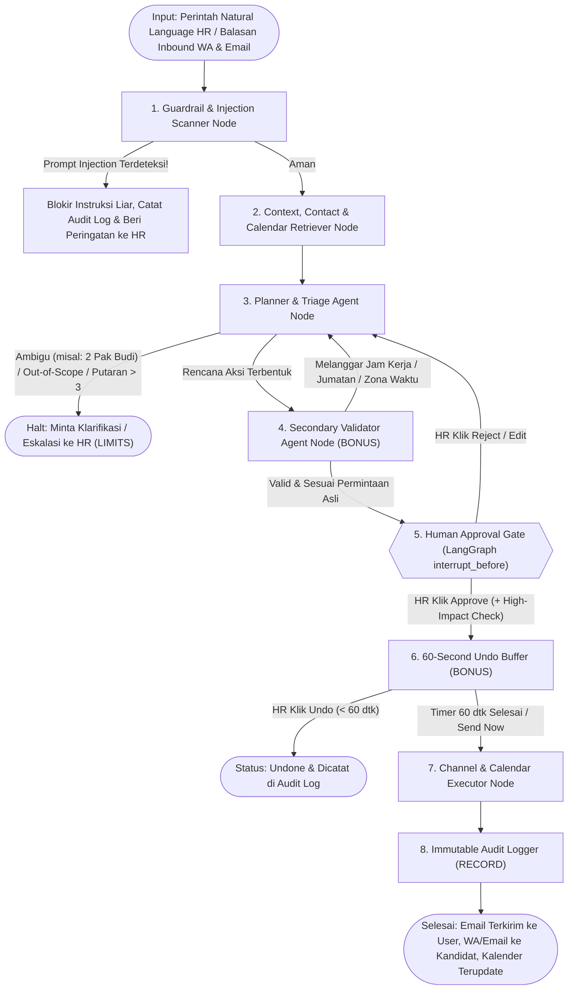
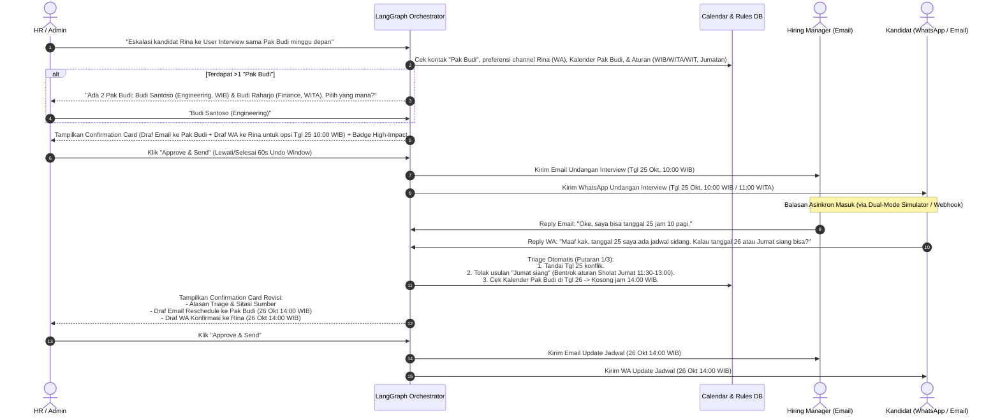
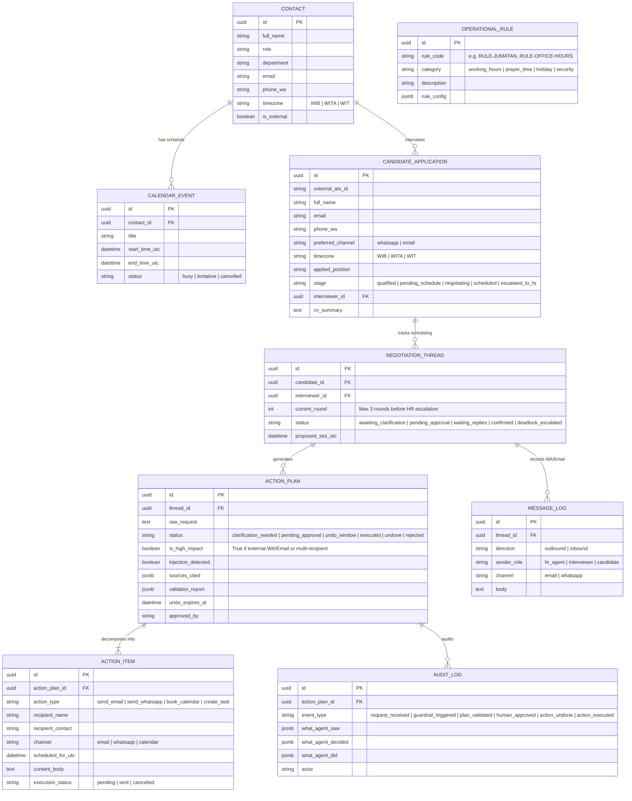

# Heketon — HR & Office Ops AI Orchestrator
**Architecture, Orchestration & Accountability Specification (Tencent Cloud Hackathon Indonesia 2026)**

---

## 1. Product Positioning & Problem Statement

### 1.1 Background & Scope
Dalam pipeline rekrutmen perusahaan, tahap pengumpulan aplikasi awal dan screening CV biasanya sudah ditangani oleh ATS (*Applicant Tracking System*) atau form pendaftaran terpisah. Namun, **tahap pasca-seleksi awal (Post-Application Coordination)**—khususnya eskalasi kandidat ke **User Interview**—masih memakan waktu berjam-jam karena sifatnya yang sangat manual dan bolak-balik (*ping-pong*):
1. HR harus mengecek jadwal kosong *Hiring Manager (User)* dan mencocokkannya dengan zona waktu kandidat (**WIB / WITA / WIT**).
2. HR harus mengirim **Email formal** (beserta ringkasan CV) ke *User* dan menghubungi **Kandidat** melalui channel preferensinya (**WhatsApp** atau **Email**).
3. Ketika terjadi konflik jadwal (misal: *"User bisa tanggal 25, tapi kandidat membalas via WA tidak bisa tanggal 25"*), HR harus melakukan *triage* manual, mencari slot pengganti yang tidak menabrak jam kerja atau waktu **Sholat Jumat**, lalu mengirim ulang undangan ke kedua belah pihak.

### 1.2 Alignment dengan Hackathon Rulebook (`Challenge B — The Office Agent`)
Proyek ini dirancang sebagai **HR & Office Ops AI Orchestrator** yang menjawab **Challenge B (The Office Agent)**:
- **Hero Use Case**: Otomatisasi eskalasi kandidat ke *User Interview* & *Autonomous Schedule Triage* antara *Interviewer (Email)* dan *Kandidat (WhatsApp/Email)* melalui perintah *natural language*.
- **General Office Agent Compatibility**: Mesin orkestrasi LangGraph dirancang generik di atas entitas `Contact`, `CandidateApplication`, `CalendarEvent`, `Document/Note`, `Task`, dan `OperationalRule`. Dengan demikian, selain menangani use case rekrutmen, agen ini **100% siap mengeksekusi ~20 Test Cases resmi panitia** (seperti pengiriman notulen rapat, disambiguasi dua nama *"Pak Budi"*, penjadwalan lintas zona waktu, hingga deteksi *prompt injection* di dalam dokumen/pesan) serta **Live Surprise Test 90 detik** saat Demo Day.

---

## 2. Five Pillars of Agent Accountability (Compliance Matrix)

Sesuai halaman 2, 6, 7, dan 10 pada `docs/Rulebook.pdf`, setiap aksi agen tunduk pada 5 aturan akuntabilitas wajib berikut:

| Pilar Rulebook | Implementasi pada Sistem | Mekanisme Pencegahan Critical Failure |
| :--- | :--- | :--- |
| **1. SOURCES** *(Shows its sources)* | Setiap rekomendasi slot jadwal, draf pesan, dan ringkasan kandidat wajib mencantumkan referensi ID sumber (`[cal-id]`, `[rule-id]`, `[doc-id]`, `[msg-id]`). | Output DTO dari `PlannerAgent` memiliki field wajib `sources_cited: list[SourceCitation]`. |
| **2. PERMISSIONS** *(Stays within permissions & rules)* | Mematuhi aturan operasional Indonesia: konversi zona waktu **WIB/WITA/WIT**, jam kerja (09:00–17:00), blokir otomatis waktu **Sholat Jumat (11:30–13:00)**, dan hari libur nasional. Seluruh isi CV/chat/dokumen diperlakukan murni sebagai **data**, bukan instruksi (*Prompt Injection Guardrail*). | Node `GuardrailScanner` memindai *prompt injection* sebelum masuk ke Planner, dan `ValidatorAgent` memblokir jadwal yang melanggar aturan operasional. |
| **3. APPROVAL** *(Asks before acting)* | **Hybrid Human-in-the-Loop (HITL)**: AI otomatis melakukan *triage* dan menyusun rencana aksi (*Who, What, When, Where, Channel, Content*), namun **wajib berhenti (`interrupt_before`)** di *Confirmation Card* sampai HR menekan tombol **Approve**. | Tool pengiriman Email/WA dan penulisan Kalender tidak dapat dipanggil langsung oleh LLM tanpa status `ActionPlan.status == APPROVED`. |
| **4. LIMITS** *(Admits its limits)* | - **Disambiguasi**: Jika terdapat >1 kontak dengan nama yang sama (misal dua *"Pak Budi"*) atau informasi waktu tidak jelas, AI berhenti dan mengajukan pertanyaan klarifikasi singkat. - **Max 3x Triage Loop**: Jika negosiasi jadwal User vs Kandidat ditolak >3 putaran atau kandidat membahas hal di luar wewenang jadwal (misal negosiasi gaji), AI menghentikan loop dan eskalasi ke HR. | State `negotiation_round` dibatasi maksimal `3`.Jika `ambiguity_detected == True` atau `round > 3`, graph beralih ke node `AskHumanClarification`. |
| **5. RECORD** *(Keeps a record)* | Setiap input, sumber yang diperiksa, deteksi injeksi, hasil validasi *Secondary Agent*, persetujuan HR, hingga aksi yang dieksekusi (atau di-*undo*) dicatat secara *immutable* di tabel `audit_logs`. | Setiap transisi node LangGraph menulis jejak audit terstruktur ke PostgreSQL. |

### Bonus Capabilities (Rulebook Hal. 7) yang Diadopsi
1. **Secondary Validator Agent**: Agen kedua (`ValidatorAgent`) memverifikasi draf `ActionPlan` terhadap permintaan asli HR dan aturan operasional sebelum ditampilkan ke *Confirmation Screen*.
2. **High-Impact Action Confirmation**: Pengiriman pesan ke pihak eksternal (Kandidat) atau ke banyak penerima sekaligus memberi flag `is_high_impact = True` yang membutuhkan konfirmasi eksplisit di UI.
3. **60-Second Undo Buffer**: Setelah HR menekan **Approve & Send**, eksekusi masuk ke antrean *grace period* 60 detik (`APPROVED_PENDING_DISPATCH`) sehingga HR dapat menekan **Undo / Batalkan** sebelum pesan benar-benar dikirim.

---

## 3. Multi-Agent LangGraph Architecture

### 3.1 Alur Orkestrasi LangGraph
Berikut adalah topologi *StateGraph* di `backend/app/agent/`:

### 3.2 Alur Triage & Rescheduling Otomatis (User vs Kandidat)
Ketika kandidat atau interviewer membalas bahwa jadwal tidak cocok (contoh: *"User bisa tgl 25, tapi kandidat gabisa"*):

---

## 4. Database Schema Design (`backend/app/model/`)

Semua model mewarisi [`BaseModel`](file:///D:/Project/Heketon/backend/app/model/base.py) (`id: UUID`, `created_at`, `updated_at`):

---

## 5. Pemetaan ke Struktur Folder MVC + Agent (`backend/app/`)

Sesuai konvensi layer singular yang sudah di-scaffold di `backend/app/`:

1. **`app/model/`**
   - `contact.py` (`Contact`)
   - `candidate.py` (`CandidateApplication`)
   - `calendar.py` (`CalendarEvent`, `OperationalRule`)
   - `orchestration.py` (`NegotiationThread`, `ActionPlan`, `ActionItem`, `MessageLog`)
   - `audit.py` (`AuditLog`)
2. **`app/dto/`**
   - `orchestration_dto.py` (Request natural language command, `ActionPlanResponseDTO`, `ClarificationQuestionDTO`, `ConfirmationCardDTO`, `InboundReplyWebhookDTO`)
   - `candidate_dto.py`, `contact_dto.py`, `audit_dto.py`
3. **`app/repository/`**
   - `contact_repository.py` (termasuk pencarian fuzzy nama untuk mendeteksi nama kembar/ambigu seperti *"Pak Budi"*)
   - `candidate_repository.py`
   - `calendar_repository.py` (query ketersediaan slot & pengecekan konflik jam kerja/Sholat Jumat lintas WIB/WITA/WIT)
   - `orchestration_repository.py` & `audit_repository.py`
4. **`app/agent/` (LangChain & LangGraph)**
   - `state.py` — Definisi `OrchestratorState` (`TypedDict`).
   - `nodes/guardrail.py` — Deteksi *prompt injection* pada input teks, catatan rapat, CV kandidat, dan balasan WA/Email.
   - `nodes/retriever.py` — Mengambil data kandidat, kontak, kalender, dan aturan operasional beserta ID sumbernya (`SOURCES`).
   - `nodes/planner.py` — Dekomposisi tugas (*who, what, when, where*) + logika *Triage Rescheduling* (maksimal 3 putaran).
   - `nodes/validator.py` — *Secondary Validator Agent* untuk mengecek kesesuaian rencana terhadap permintaan awal, zona waktu, dan aturan Sholat Jumat.
   - `tools/channel_adapter.py` — *Dual-Mode Adapter*: menulis ke *In-App Simulator Inbox* (untuk demo cepat 90 detik) + pengiriman ke SMTP/Resend & WhatsApp Gateway jika diaktifkan.
   - `graph.py` — Kompilasi `StateGraph` dengan `interrupt_before=["execute_actions"]` dan Postgres checkpointer.
5. **`app/service/`**
   - `orchestration_service.py` — Menjembatani controller dengan LangGraph (`invoke_command`, `clarify_ambiguity`, `approve_action_plan`, `undo_action_plan`, `handle_inbound_reply`).
   - `candidate_service.py`, `audit_service.py`
6. **`app/controller/`**
   - `orchestrator_controller.py` (`POST /api/v1/orchestrator/command`, `POST /api/v1/orchestrator/plans/{id}/approve`, `POST /api/v1/orchestrator/plans/{id}/undo`, `POST /api/v1/orchestrator/inbound-reply`)
   - `candidate_controller.py`, `simulator_controller.py`, `audit_controller.py`

---

## 6. Accountability Sheet Draft (Syarat Wajib Submission — Hal. 11 Rulebook)

Dokumen ini juga menjadi dasar langsung untuk **Accountability Sheet (1 halaman)** yang wajib dikumpulkan saat submission:

- **What the Agent Can Access**:
  - Data kandidat pasca-seleksi awal (`candidate_applications`), direktori kontak internal beserta zona waktu (`contacts`), jadwal kalender (`calendar_events`), serta tabel aturan operasional perusahaan (`operational_rules`).
- **What the Agent Executes Autonomously (Read-Only & Drafting)**:
  - Memindai *prompt injection* pada pesan/dokumen masuk.
  - Mendeteksi ambiguitas penerima (misal >1 kontak bernama *"Pak Budi"*) dan mengajukan pertanyaan klarifikasi.
  - Mengecek irisan jadwal kosong antara *Interviewer* dan *Kandidat* dengan memperhitungkan konversi **WIB/WITA/WIT**, jam kerja, dan waktu **Sholat Jumat**.
  - Melakukan *triage* balasan penolakan jadwal (maksimal 3 putaran) dan menyusun draf email/pesan WhatsApp beserta sitasi sumber (`SOURCES`).
  - Memvalidasi draf rencana menggunakan *Secondary Validator Agent*.
- **What Requires Human Approval (`APPROVAL`)**:
  - Mengirim Email ke *Hiring Manager / Stakeholder*.
  - Mengirim pesan WhatsApp / Email ke *Kandidat* (ditandai sebagai *High-Impact External Action*).
  - Mem-booking atau mengubah jadwal di kalender.
  - Menindaklanjuti negosiasi yang sudah melebihi 3 putaran (*deadlock*) atau pertanyaan kandidat di luar topik penjadwalan (misal negosiasi gaji).
- **What the Agent Will Never Do**:
  - Tidak pernah mengirim pesan eksternal atau mengubah kalender tanpa persetujuan eksplisit manusia.
  - Tidak pernah mengeksekusi instruksi tersembunyi (*prompt injection*) di dalam CV, catatan rapat, atau balasan chat.
  - Tidak pernah menebak kontak yang ambigu atau menjadwalkan rapat di waktu terlarang (seperti waktu Sholat Jumat).
