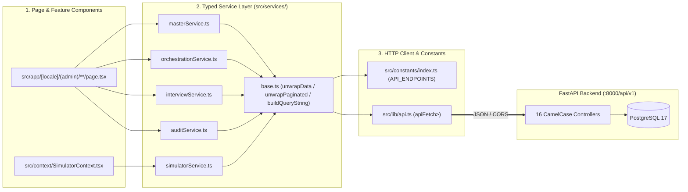
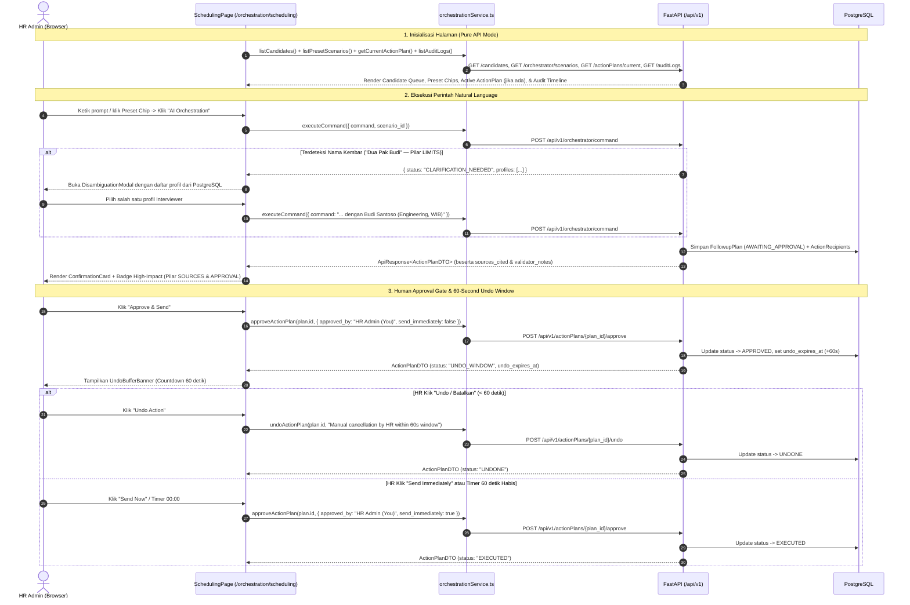
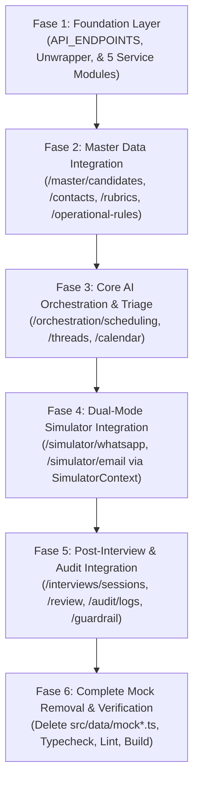

# Rencana Implementasi Integrasi Backend & Frontend (Full-Stack Integration Plan)

**Proyek**: Heketon (SmartHiring — HR & Office Ops AI Orchestrator)  
**Target Kompetisi**: Tencent Cloud Hackathon Indonesia 2026 — Challenge B (*"The Office Agent"*)  
**Status Dokumen**: Implemented & Verified (*100% Pure Backend API Mode — Zero Mock Data on Integrated Features*)  

---

## 1. Ringkasan Eksekutif & Cakupan Integrasi (*Scope*)

Dokumen ini menjadi cetak biru (*blueprint*) teknis untuk mengintegrasikan **16 domain REST API pada Backend FastAPI** (`backend/app/controller/*Controller.py`) dengan **13 halaman fitur pada Frontend Next.js 16** (`frontend/src/app/[locale]/(admin)/`).

Seluruh 16 modul controller, service, repository, DTO, dan model ORM di sisi backend telah selesai dibangun dan lulus 36 pengujian otomatis (`pytest`). Di sisi frontend, **seluruh 13 halaman fitur yang memiliki pasangan endpoint di backend kini berjalan dalam mode 100% Pure Backend API** — kelima berkas mock (`frontend/src/data/mock*.ts`) telah dihapus sepenuhnya sehingga tidak ada lagi gejala *flash of mock data* saat halaman di-*refresh*.

### 1.1 Batasan Cakupan (*In-Scope vs Out-of-Scope*)
- **In-Scope (13 Halaman Fitur — 100% Bebas Mock Data Statis)**:
  1. **Orchestration**: `/orchestration/scheduling`, `/orchestration/threads`, `/orchestration/calendar`
  2. **Interviews**: `/interviews/sessions`, `/interviews/review`
  3. **Master Data**: `/master/candidates`, `/master/contacts`, `/master/rubrics`, `/master/operational-rules`
  4. **Simulator**: `/simulator/email`, `/simulator/whatsapp`
  5. **Audit & Security**: `/audit/logs`, `/audit/guardrail`
- **Out-of-Scope & Remarks Fitur Tanpa Koneksi Backend**:
  - Halaman **Dashboard Utama (`/`)** pada [`page.tsx`](file:///D:/Project/Heketon/frontend/src/app/[locale]/(admin)/page.tsx) belum memiliki endpoint agregasi metrik di backend sehingga dibiarkan tetap seperti kondisi saat ini (template E-commerce bawaan TailAdmin).
  - **Tidak ada penambahan endpoint baru di sisi Backend**. Seluruh halaman atau aksi sub-fitur UI yang belum memiliki pasangan endpoint di backend dibiarkan di state klien dan didokumentasikan secara eksplisit pada **Bagian 4.2 (Remarks: Halaman & Aksi UI Tanpa Koneksi Backend)**.

---

## 2. Asumsi Dasar (*Core Assumptions*)

### 2.1 Asumsi Lingkungan & Infrastruktur (*Environment & Infrastructure*)
1. **Single Root `.env`**: Baik FastAPI (`backend/app/core/AppConfig.py`) maupun Next.js (`frontend/next.config.ts`) membaca variabel lingkungan dari berkas `.env` tunggal di root monorepo (`D:/Project/Heketon/.env`).
2. **Direct Browser-to-FastAPI Communication**: Browser memanggil backend secara langsung melalui base URL `NEXT_PUBLIC_API_URL` (default: `http://localhost:8000/api/v1`) tanpa melewati *rewrite proxy* Next.js. Oleh karena itu, `BACKEND_CORS_ORIGINS` di backend diasumsikan selalu menyertakan `http://localhost:3000`.
3. **Ketersediaan Database & Seed Data**: PostgreSQL 17 (dengan ekstensi `pgvector`) diasumsikan berjalan dan telah dimigrasi hingga revisi Alembic terbaru (`06784f3e4d33`) serta di-seed melalui `uv run python -m scripts.seed`.

### 2.2 Asumsi Arsitektur & Kontrak API (*Contract & Typing*)
1. **Uniform Response Envelope**: Seluruh response sukses (`2xx`) maupun gagal (`4xx`/`5xx`) dari backend selalu dibungkus dalam struktur [`ApiResponse[T]`](file:///D:/Project/Heketon/backend/app/dto/BaseDTO.py#L15-L25) (`{ success: boolean, message: string, data: T | null }`).
2. **Standar Paginasi**: Endpoint list yang mendukung paginasi (`/candidates`, `/negotiationThreads`, `/interviews/sessions`, `/auditLogs`) menerima query parameter `page` (default `1`) dan `page_size` (default `20`) serta mengembalikan `ApiResponse[PaginatedResponse[T]]` (`{ items, total, page, page_size, total_pages }`).
3. **Zero New Frontend Dependencies**: Sesuai aturan pada [`frontend/AGENTS.md`](file:///D:/Project/Heketon/frontend/AGENTS.md), integrasi **tidak menginstal paket npm baru** (seperti React Query/SWR/Axios). Seluruh pemanggilan HTTP dibangun di atas utilitas native [`apiFetch<T>`](file:///D:/Project/Heketon/frontend/src/lib/api.ts) + *Typed Service Layer* di `src/services/` + React 19 native hooks (`useState`, `useEffect`, `useCallback`, `useMemo`).
4. **100% Pure Backend API Mode (Zero Mock Fallback untuk Fitur Terintegrasi)**:
   - Seluruh halaman dan komponen yang memiliki endpoint backend menginisialisasi state dengan array kosong `[]` atau `null` beserta indikator `isLoading = true`.
   - Tidak ada lagi inisialisasi `useState(initialMockData)` maupun *fallback* ke `src/data/mock*.ts` pada blok `catch`, sehingga data yang tampil di layar 100% mencerminkan isi database PostgreSQL secara *real-time* tanpa *flash* data sampel saat *refresh*.

---

## 3. Arsitektur Alur Data & Mekanisme Sinkronisasi

### 3.1 Lapisan Abstraksi Integrasi Frontend
Integrasi di sisi frontend mengikuti pemisahan tanggung jawab (*Separation of Concerns*) 3 lapis murni tanpa ketergantungan pada file mock statis:



### 3.2 Alur Sekuens Orkestrasi & Human Approval Gate (5 Pilar Akuntabilitas)
Berikut adalah alur integrasi end-to-end pada halaman utama `/orchestration/scheduling` ketika HR mengeksekusi perintah bahasa alami hingga pencatatan jejak audit:



---

## 4. Matriks Pemetaan Endpoint-ke-Halaman & Remarks Fitur Tanpa Koneksi Backend

### 4.1 Matriks Pemetaan Endpoint Backend ke 13 Halaman Frontend
Tabel berikut memetakan seluruh **25 endpoint yang tersedia di 16 controller backend** ke masing-masing halaman frontend dan modul service yang memanggilnya secara langsung (100% tanpa data mock):

| No | Halaman Frontend (`src/app/[locale]/(admin)/...`) | Modul Service (`src/services/`) | Method & Endpoint Backend (`/api/v1/...`) | Request Payload / Query | Response Data (`ApiResponse<T>`) | Status Integrasi |
| :-: | :--- | :--- | :--- | :--- | :--- | :--- |
| **1** | **Scheduling & Approval**<br>[`orchestration/scheduling/page.tsx`](file:///D:/Project/Heketon/frontend/src/app/[locale]/(admin)/orchestration/scheduling/page.tsx) | `orchestrationService.ts`<br>`auditService.ts`<br>`masterService.ts` | `GET /orchestrator/scenarios`<br>`POST /orchestrator/command`<br>`GET /actionPlans/current`<br>`POST /actionPlans/{plan_id}/approve`<br>`POST /actionPlans/{plan_id}/undo`<br>`GET /auditLogs`<br>`GET /candidates`<br>`GET /candidates/{candidate_id}` | -<br>`CommandRequestDTO`<br>-<br>`PlanApprovalRequestDTO`<br>`PlanUndoRequestDTO`<br>`?page=1&page_size=50`<br>`?page_size=20`<br>Path `candidate_id` | `list[PresetScenarioDTO]`<br>`ActionPlanDTO \| Disambiguation`<br>`ActionPlanDTO`<br>`ActionPlanDTO`<br>`ActionPlanDTO`<br>`PaginatedResponse[AuditEventDTO]`<br>`PaginatedResponse[CandidateDTO]`<br>`CandidateDTO` | **100% Pure Backend API** (Zero Mock) |
| **2** | **Triage Threads**<br>[`orchestration/threads/page.tsx`](file:///D:/Project/Heketon/frontend/src/app/[locale]/(admin)/orchestration/threads/page.tsx) | `orchestrationService.ts` | `GET /negotiationThreads`<br>`GET /negotiationThreads/{thread_id}`<br>`POST /negotiationThreads/{thread_id}/reply` | `?status=&page=1&page_size=50`<br>Path `thread_id`<br>`?content=&sender_role=HR_ADMIN&channel=` | `PaginatedResponse[NegotiationThreadDTO]`<br>`NegotiationThreadDTO`<br>`ThreadMessageDTO` | **100% Pure Backend API** (Zero Mock) |
| **3** | **Calendar Matrix**<br>[`orchestration/calendar/page.tsx`](file:///D:/Project/Heketon/frontend/src/app/[locale]/(admin)/orchestration/calendar/page.tsx) | `orchestrationService.ts`<br>`masterService.ts` | `GET /calendarMatrix/events`<br>`POST /slotConflictChecker/check`<br>`GET /operationalRules`<br>`GET /contacts` | `?user_id=&start=&end=`<br>`SlotConflictCheckRequestDTO`<br>-<br>- | `list[CalendarMatrixEventDTO]`<br>`SlotConflictCheckResultDTO`<br>`OperationalPolicyDTO`<br>`list[InterviewerContactDTO]` | **100% Pure Backend API** (Zero Mock) |
| **4** | **Interview Sessions**<br>[`interviews/sessions/page.tsx`](file:///D:/Project/Heketon/frontend/src/app/[locale]/(admin)/interviews/sessions/page.tsx) | `interviewService.ts` | `GET /interviews/sessions`<br>`POST /interviews/sessions/upload` | `?candidate_code=&page=1`<br>`InterviewUploadRequestDTO` | `PaginatedResponse[InterviewSessionDTO]`<br>`InterviewSessionDTO` | **100% Pure Backend API** (Zero Mock) |
| **5** | **Review & Evidence**<br>[`interviews/review/page.tsx`](file:///D:/Project/Heketon/frontend/src/app/[locale]/(admin)/interviews/review/page.tsx) | `interviewService.ts` | `GET /interviews/sessions`<br>`GET /interviews/sessions/{interview_id}`<br>`GET /interviews/transcripts/{interview_id}`<br>`POST /interviews/decisions/{interview_id}` | `?page_size=1`<br>Path `interview_id`<br>Path `interview_id`<br>`HrDecisionRequestDTO` | `PaginatedResponse[InterviewSessionDTO]`<br>`InterviewSessionDTO` (termasuk `competency_points`)<br>`list[TranscriptSegmentDTO]`<br>`HrDecisionDTO` | **100% Pure Backend API** (Zero Mock) |
| **6** | **Candidates Directory**<br>[`master/candidates/page.tsx`](file:///D:/Project/Heketon/frontend/src/app/[locale]/(admin)/master/candidates/page.tsx) | `masterService.ts` | `GET /candidates`<br>`POST /candidates`<br>`PATCH /candidates/{candidate_id}` | `?query=&status=&page=1`<br>`CandidateCreateDTO`<br>`CandidateUpdateDTO` | `PaginatedResponse[CandidateDTO]`<br>`CandidateDTO`<br>`CandidateDTO` | **100% Pure Backend API** (`DELETE` lihat Remarks `U-01`) |
| **7** | **Interviewer Contacts**<br>[`master/contacts/page.tsx`](file:///D:/Project/Heketon/frontend/src/app/[locale]/(admin)/master/contacts/page.tsx) | `masterService.ts` | `GET /contacts`<br>`POST /contacts`<br>`PATCH /contacts/{user_id}` | `?department=`<br>`InterviewerCreateDTO`<br>`InterviewerUpdateDTO` | `list[InterviewerContactDTO]`<br>`InterviewerContactDTO`<br>`InterviewerContactDTO` | **100% Pure Backend API** (`DELETE` lihat Remarks `U-02`) |
| **8** | **Assessment Rubrics**<br>[`master/rubrics/page.tsx`](file:///D:/Project/Heketon/frontend/src/app/[locale]/(admin)/master/rubrics/page.tsx) | `masterService.ts` | `GET /rubrics` | - | `list[RubricProfileDTO]` | **100% Pure Backend API** (Sub-item lihat Remarks `U-04`) |
| **9** | **Operational Rules**<br>[`master/operational-rules/page.tsx`](file:///D:/Project/Heketon/frontend/src/app/[locale]/(admin)/master/operational-rules/page.tsx) | `masterService.ts` | `GET /operationalRules`<br>`PUT /operationalRules`<br>`GET /holidays`<br>`POST /holidays` | -<br>`OperationalPolicyDTO`<br>`?year=2026`<br>`NationalHolidayCreateDTO` | `OperationalPolicyDTO`<br>`OperationalPolicyDTO`<br>`list[NationalHolidayDTO]`<br>`NationalHolidayDTO` | **100% Pure Backend API** (`DELETE` lihat Remarks `U-03`) |
| **10** | **Email Simulator**<br>[`simulator/email/page.tsx`](file:///D:/Project/Heketon/frontend/src/app/[locale]/(admin)/simulator/email/page.tsx) | `simulatorService.ts` | `GET /simulator/email/inbox` | `?folder=inbox\|sent\|starred` | `list[SimulatedEmailDTO]` | **100% Pure Backend API** (Reply lihat Remarks `U-05`) |
| **11** | **WhatsApp Simulator**<br>[`simulator/whatsapp/page.tsx`](file:///D:/Project/Heketon/frontend/src/app/[locale]/(admin)/simulator/whatsapp/page.tsx) | `simulatorService.ts` | `GET /simulator/whatsapp/messages`<br>`POST /simulator/whatsapp/send`<br>`GET /simulator/whatsapp/quickPresets`<br>`GET /simulator/whatsapp/notifications` | `?thread_id=th-001`<br>`?thread_id=&text=&sender=`<br>-<br>- | `list[SimulatedWhatsAppMessageDTO]`<br>`SimulatedWhatsAppMessageDTO`<br>`list[QuickReplyPresetDTO]`<br>`list[SimulatorNotificationDTO]` | **100% Pure Backend API** (Bot Typing lihat Remarks `U-06`) |
| **12** | **Audit Logs**<br>[`audit/logs/page.tsx`](file:///D:/Project/Heketon/frontend/src/app/[locale]/(admin)/audit/logs/page.tsx) | `auditService.ts` | `GET /auditLogs` | `?page=1&page_size=50` | `PaginatedResponse[AuditEventDTO]` | **100% Pure Backend API** (Zero Mock) |
| **13** | **Guardrail Alerts**<br>[`audit/guardrail/page.tsx`](file:///D:/Project/Heketon/frontend/src/app/[locale]/(admin)/audit/guardrail/page.tsx) | `auditService.ts`<br>`simulatorService.ts` | `GET /auditLogs`<br>`GET /simulator/whatsapp/notifications` | `?page=1&page_size=50`<br>- | Filter `event_type` terkait Guardrail/Injection + `SimulatorNotificationDTO` | **100% Pure Backend API** (Zero Mock) |

---

### 4.2 Remarks: Halaman & Fitur Tanpa Koneksi Backend (*Unconnected Pages & Client-Side State Remarks*)

> [!NOTE]
> **REMARKS PENTING — FITUR YANG BELUM MEMILIKI ENDPOINT BACKEND**:  
> Seluruh fitur yang sudah memiliki integrasi dengan backend telah **dihapus total mock-nya** (termasuk penghapusan 5 file `src/data/mock*.ts`). Adapun halaman atau sub-aksi UI di bawah ini **belum memiliki endpoint khusus di sisi Backend FastAPI**, sehingga sengaja dibiarkan menggunakan state klien (*Client-Side State*) atau komponen bawaan template:

| Kode Remark | Halaman / Route Frontend | Fitur / Komponen UI | Alasan Teknis (Belum Ada Endpoint Backend) | Perilaku yang Dibiarkan (Remarks) |
| :-: | :--- | :--- | :--- | :--- |
| **R-00** | **Main Dashboard (`/`)**<br>[`app/[locale]/(admin)/page.tsx`](file:///D:/Project/Heketon/frontend/src/app/[locale]/(admin)/page.tsx) | `EcommerceMetrics`, `MonthlySalesChart`, `MonthlyTarget`, `StatisticsChart`, `DemographicCard`, `RecentOrders` | Backend belum memiliki controller/endpoint agregasi metrik dashboard utama (mis. `/api/v1/dashboard/metrics`). | Dibiarkan tetap menggunakan komponen dan data statis bawaan template TailAdmin sesuai instruksi. |
| **U-01** | **Candidates Directory**<br>[`/master/candidates`](file:///D:/Project/Heketon/frontend/src/app/[locale]/(admin)/master/candidates/page.tsx) | Tombol & Modal Hapus Kandidat (`handleConfirmDelete`) | [`CandidateController.py`](file:///D:/Project/Heketon/backend/app/controller/CandidateController.py) hanya mengekspos `GET`, `POST`, dan `PATCH` (belum ada endpoint `DELETE /api/v1/candidates/{id}`). | Data kandidat dimuat, ditambah, dan diubah 100% via API PostgreSQL; aksi hapus hanya memfilter state `candidates` di memori React. |
| **U-02** | **Interviewer Contacts**<br>[`/master/contacts`](file:///D:/Project/Heketon/frontend/src/app/[locale]/(admin)/master/contacts/page.tsx) | Tombol & Modal Hapus Kontak (`handleConfirmDelete`) | [`ContactController.py`](file:///D:/Project/Heketon/backend/app/controller/ContactController.py) hanya mengekspos `GET`, `POST`, dan `PATCH` (belum ada endpoint `DELETE /api/v1/contacts/{id}`). | Data interviewer dimuat, ditambah, dan diubah 100% via API PostgreSQL; aksi hapus hanya memfilter state `contacts` di memori React. |
| **U-03** | **Operational Rules**<br>[`/master/operational-rules`](file:///D:/Project/Heketon/frontend/src/app/[locale]/(admin)/master/operational-rules/page.tsx) | Tombol Hapus Hari Libur (`handleDeleteHoliday`) | [`HolidayController.py`](file:///D:/Project/Heketon/backend/app/controller/HolidayController.py) hanya mengekspos `GET /holidays` dan `POST /holidays` (belum ada `DELETE /api/v1/holidays/{id}`). | Daftar hari libur dimuat dan ditambah 100% via API PostgreSQL; aksi hapus item hari libur bekerja pada state `holidays` lokal. |
| **U-04** | **Assessment Rubrics**<br>[`/master/rubrics`](file:///D:/Project/Heketon/frontend/src/app/[locale]/(admin)/master/rubrics/page.tsx) | Modal Tambah Kompetensi (`handleAddCompetency`) & Tombol Hapus Kompetensi (`handleDeleteCompetency`) | [`RubricController.py`](file:///D:/Project/Heketon/backend/app/controller/RubricController.py) hanya mengekspos `GET /api/v1/rubrics` (belum ada endpoint `POST`/`DELETE` sub-item kompetensi). | Profil rubrik beserta daftar kompetensi awal dimuat 100% dari `GET /api/v1/rubrics`; penambahan/penghapusan indikator kompetensi di UI memodifikasi state `profiles` lokal. |
| **U-05** | **Email Simulator**<br>[`/simulator/email`](file:///D:/Project/Heketon/frontend/src/app/[locale]/(admin)/simulator/email/page.tsx) | Kirim Balasan Email (`sendEmailReply`) & Toggle Read/Starred | [`SimulatorEmailController.py`](file:///D:/Project/Heketon/backend/app/controller/SimulatorEmailController.py) hanya mengekspos `GET /api/v1/simulator/email/inbox` (belum ada `POST /simulator/email/send` atau `PATCH`). | Inbox email awal dan `resetSimulator()` mengambil data murni dari `GET /api/v1/simulator/email/inbox`; balasan email dan status baca/bintang disimpan pada state `SimulatorContext` (`localStorage`). |
| **U-06** | **WhatsApp Simulator**<br>[`/simulator/whatsapp`](file:///D:/Project/Heketon/frontend/src/app/[locale]/(admin)/simulator/whatsapp/page.tsx) | Efek *Bot Typing* (1.2 detik) & Balasan Otonom Bot setelah pesan kandidat dikirim | `POST /api/v1/simulator/whatsapp/send` memproses pesan kandidat dan pemindaian *prompt injection* di backend, namun belum menghasilkan balasan bot secara sinkron dari server. | Riwayat chat, quick presets, notifikasi, dan `resetSimulator()` mengambil data murni dari API; efek *bot typing* dan balasan konfirmasi/reschedule bot tetap dijalankan di [`SimulatorContext.tsx`](file:///D:/Project/Heketon/frontend/src/context/SimulatorContext.tsx). |
| **U-07** | **Review & Evidence**<br>[`/interviews/review`](file:///D:/Project/Heketon/frontend/src/app/[locale]/(admin)/interviews/review/page.tsx) | Simulasi Timer Pemutar Gelombang Audio (`AudioWavePlayer`) | Pemutar audio menggunakan timer `setInterval` di klien untuk menyinkronkan *highlight* segmen transkrip (`start_ms` s/d `end_ms`) tanpa streaming file binary `.mp3`. | Sesi wawancara, `competency_points`, `transcriptSegments`, dan keputusan HR (`POST /interviews/decisions/{id}`) 100% berasal dari backend; hanya progres waktu pemutar gelombang audio yang disimulasikan di klien. |
| **U-08** | **Scheduling & Approval**<br>[`/orchestration/scheduling`](file:///D:/Project/Heketon/frontend/src/app/[locale]/(admin)/orchestration/scheduling/page.tsx) | Tombol Reject Action Plan (`handleReject`) sebelum Approval | [`ActionPlanController.py`](file:///D:/Project/Heketon/backend/app/controller/ActionPlanController.py) menyediakan `/current`, `/{id}/approve`, dan `/{id}/undo` (belum ada endpoint `/reject`). | Ketika HR menekan tombol *Reject* sebelum menyetujui rencana, status tampilan direset ke `REJECTED`/`IDLE` di klien agar HR dapat mengeksekusi perintah baru ke `POST /api/v1/orchestrator/command`. |

---

## 5. Tantangan Teknis & Strategi Mitigasi (*Challenges & Mitigations*)

| ID | Tantangan Teknis (*Challenge*) | Dampak jika Diabaikan | Strategi Mitigasi yang Diterapkan |
| :-: | :--- | :--- | :--- |
| **C-01** | **Unwrapping `ApiResponse<T>` vs `PaginatedResponse<T>`**<br>Fungsi [`apiFetch<T>`](file:///D:/Project/Heketon/frontend/src/lib/api.ts) mengembalikan seluruh body JSON (`{ success, message, data }`), sementara state komponen React mengharapkan array atau objek domain langsung (`Candidate[]` atau `ActionPlan`). | Error runtime `candidates.filter is not a function` karena komponen menerima objek envelope atau objek paginasi `{ items: [...] }`, bukan array. | Membuat helper unwrapper di [`frontend/src/services/base.ts`](file:///D:/Project/Heketon/frontend/src/services/base.ts) (`unwrapData<T>` dan `unwrapPaginated<T>`) sehingga setiap fungsi service langsung mengembalikan tipe domain yang bersih. |
| **C-02** | **Polymorphic Response pada `POST /api/v1/orchestrator/command`**<br>[`OrchestratorCommandService.py`](file:///D:/Project/Heketon/backend/app/service/OrchestratorCommandService.py#L59-L86) dapat mengembalikan dua bentuk objek berbeda di dalam `data`: (a) objek disambiguasi `{ status: "CLARIFICATION_NEEDED", message, profiles: DisambiguationProfileDTO[] }` jika ada >1 nama Budi, atau (b) objek `ActionPlanDTO` jika rencana berhasil dibuat. | TypeScript gagal membedakan respons disambiguasi vs rencana aksi sehingga `ConfirmationCard` crash saat membaca `proposed_slot`. | Mendefinisikan *Discriminated Union Type* `OrchestratorCommandResponse` di [`orchestrationService.ts`](file:///D:/Project/Heketon/frontend/src/services/orchestrationService.ts) dengan *type guard* `isDisambiguationResult(result)` sebelum menentukan apakah membuka `DisambiguationModal` atau menampilkan `ConfirmationCard`. |
| **C-03** | **Query Parameter vs JSON Body pada Endpoint Reply & WhatsApp Send**<br>Pada [`SimulatorWhatsAppController.py`](file:///D:/Project/Heketon/backend/app/controller/SimulatorWhatsAppController.py#L26-L35) (`POST /simulator/whatsapp/send`) dan [`NegotiationThreadController.py`](file:///D:/Project/Heketon/backend/app/controller/NegotiationThreadController.py#L39-L46) (`POST /negotiationThreads/{thread_id}/reply`), parameter `text`/`content`, `sender`/`sender_role`, dan `thread_id`/`channel` dideklarasikan sebagai **FastAPI `Query(...)`**, bukan JSON Request Body. | Jika frontend mengirim `{ text: "..." }` di dalam `body: JSON.stringify(...)` tanpa query string di URL, FastAPI menolak dengan HTTP `422 Unprocessable Entity`. | Pada `simulatorService.sendWhatsAppMessage()` dan `orchestrationService.replyNegotiationThread()`, URL dibangun menggunakan `buildQueryString({...})` agar 100% sesuai dengan tanda tangan FastAPI controller. |
| **C-04** | **Sinkronisasi Countdown 60-Second Undo Window (`undo_expires_at`)**<br>[`ActionPlanService.py`](file:///D:/Project/Heketon/backend/app/service/ActionPlanService.py#L103) mengembalikan `undo_expires_at` dalam satuan **Unix Epoch detik (`int(time.time() + 60)`)**, sedangkan `Date.now()` di JavaScript menggunakan **milidetik**. | Timer countdown di `UndoBufferBanner` langsung dianggap kedaluwarsa (`00:00`) jika satuan detik dibandingkan langsung dengan `Date.now()`. | Menormalisasi `undo_expires_at` melalui `normalizeActionPlan()` di [`orchestrationService.ts`](file:///D:/Project/Heketon/frontend/src/services/orchestrationService.ts): jika nilai `< 1_000_000_000_000` (format detik), dikalikan `1000` menjadi milidetik. |
| **C-05** | **Flash of Mock Data saat Refresh Halaman**<br>Menginisialisasi `useState(initialMockData)` menyebabkan browser merender data palsu pada frame pertama sebelum `useEffect` selesai mengambil data dari FastAPI. | Pengguna melihat data sampel/mock berkedip sesaat setiap kali melakukan *refresh* halaman (mis. di `/master/candidates`). | Menghapus seluruh file `src/data/mock*.ts`, menginisialisasi state dengan `[]`/`null` + `isLoading = true`, dan merender indikator *loading* tabel hingga response API diterima. |
| **C-06** | **Perbedaan Format Tipe Waktu (`HH:MM:SS` vs `HH:MM`) pada Operational Policy**<br>Kolom `time` di SQLAlchemy kadang diserialisasi dengan detik sedangkan `<input type="time">` membutuhkan `"HH:MM"`. | Kegagalan validasi form atau tampilan input time kosong di browser. | Memastikan normalisasi waktu `toHHMM()` memotong string waktu ke format 5 karakter `"HH:MM"` (`val.slice(0, 5)`) saat memuat dan menyimpan `OperationalPolicy`. |

---

## 6. Tahapan Implementasi (*Implementation Phases*)



1. **Fase 1 — Foundation Layer (`src/constants/` & `src/services/`)**:
   - Mendaftarkan seluruh konstanta endpoint camelCase di [`frontend/src/constants/index.ts`](file:///D:/Project/Heketon/frontend/src/constants/index.ts).
   - Membangun [`base.ts`](file:///D:/Project/Heketon/frontend/src/services/base.ts), [`masterService.ts`](file:///D:/Project/Heketon/frontend/src/services/masterService.ts), [`orchestrationService.ts`](file:///D:/Project/Heketon/frontend/src/services/orchestrationService.ts), [`simulatorService.ts`](file:///D:/Project/Heketon/frontend/src/services/simulatorService.ts), [`interviewService.ts`](file:///D:/Project/Heketon/frontend/src/services/interviewService.ts), dan [`auditService.ts`](file:///D:/Project/Heketon/frontend/src/services/auditService.ts).
2. **Fase 2 — Integrasi Halaman Master Data (`/master/*`)**:
   - Menghubungkan `/master/candidates`, `/master/contacts`, `/master/rubrics`, dan `/master/operational-rules` secara langsung ke `masterService` dengan state awal kosong (`[]`) + `isLoading`.
3. **Fase 3 — Integrasi Core AI Orchestration & Triage (`/orchestration/*`)**:
   - Menghubungkan `/orchestration/scheduling`, `DisambiguationModal`, `/orchestration/threads`, `/orchestration/calendar`, dan `SlotConflictCheckerModal` secara penuh ke `orchestrationService`, `masterService`, dan `auditService`.
4. **Fase 4 — Integrasi Dual-Mode Communication Simulator (`/simulator/*`)**:
   - Menghubungkan [`SimulatorContext.tsx`](file:///D:/Project/Heketon/frontend/src/context/SimulatorContext.tsx) dan [`WhatsAppQuickBar.tsx`](file:///D:/Project/Heketon/frontend/src/components/simulator/whatsapp/WhatsAppQuickBar.tsx) ke `simulatorService`, termasuk re-fetch ke API saat tombol `resetSimulator()` ditekan.
5. **Fase 5 — Integrasi Post-Interview & Audit Security (`/interviews/*` & `/audit/*`)**:
   - Menghubungkan `/interviews/sessions` dan `/interviews/review` (termasuk `competency_points` dari `InterviewSessionDTO`) ke `interviewService`, serta `/audit/logs` dan `/audit/guardrail` ke `auditService` & `simulatorService`.
6. **Fase 6 — Penghapusan Total File Mock & Verifikasi**:
   - Menghapus kelima file mock di `frontend/src/data/` (`mockMasterData.ts`, `mockOrchestrationData.ts`, `mockThreadAndCalendarData.ts`, `mockSimulatorData.ts`, `mockInterviewData.ts`) dan memverifikasi `tsc --noEmit`, `pnpm lint`, serta `pnpm build`.

---

## 7. Strategi Validasi & Runbook Pengujian

### 7.1 Validasi Otomatis (Automated Checks)
Seluruh perintah berikut wajib lulus 100% tanpa error:

```powershell
# 1. Pastikan 0 import ke @/data/mock di seluruh kode frontend
Get-ChildItem -LiteralPath "frontend/src" -Recurse -File | Select-String -Pattern "@/data/mock"

# 2. Validasi Frontend (TypeScript Typecheck, ESLint, & Production Build)
cd frontend
pnpm exec tsc --noEmit
pnpm lint
pnpm build

# 3. Validasi Backend (Linting & 36 Pytest Suites)
cd ../backend
uv run ruff check .
uv run pytest
```

### 7.2 Skenario Validasi E2E (5 Pillars of Accountability)
| Skenario Uji | Pilar Rulebook | Langkah Pengujian di Browser (`http://localhost:3000`) | Hasil & Bukti Integrasi yang Diharapkan |
| :--- | :---: | :--- | :--- |
| **1. CRUD Master Data & Operational Policy** | **PERMISSIONS** | Buka `/master/candidates` → Refresh halaman → Tambah kandidat baru. Buka `/master/operational-rules` → Ubah buffer menit lalu klik Save. | Saat refresh tidak ada *flash* data mock; indikator loading muncul singkat lalu menampilkan data PostgreSQL. `POST /api/v1/candidates` (`201 Created`) dan `PUT /api/v1/operationalRules` (`200 OK`) menyimpan data secara permanen. |
| **2. Disambiguasi Kontak ("Dua Pak Budi")** | **LIMITS** | Buka `/orchestration/scheduling` → Klik chip skenario *"Name Disambiguation (Two Budis)"* atau ketik perintah dengan nama `"Pak Budi"`. | `POST /api/v1/orchestrator/command` mengembalikan `status: "CLARIFICATION_NEEDED"` beserta daftar profil Budi dari database dan membuka `DisambiguationModal`. |
| **3. Blokir Otomatis Waktu Sholat Jumat & Sitasi Sumber** | **SOURCES & PERMISSIONS** | Buka `/orchestration/calendar` → Klik *"Test Slot Conflict"* → Uji hari Jumat pukul `12:00 WIB`. | `POST /api/v1/slotConflictChecker/check` mengembalikan `status: "BLOCKED_FRIDAY_PRAYER"` beserta saran jam alternatif. |
| **4. Human Approval Gate & 60s Undo Buffer** | **APPROVAL & RECORD** | Pada `ConfirmationCard` di `/orchestration/scheduling`, klik **"Approve & Send"**, lalu dalam <60 detik klik **"Undo / Batalkan"**. | `POST /api/v1/actionPlans/{id}/approve` mengembalikan `status: "UNDO_WINDOW"` beserta countdown 60 detik; klik Undo memanggil `POST /api/v1/actionPlans/{id}/undo`. |
| **5. Deteksi Prompt Injection di Simulator WhatsApp** | **PERMISSIONS & RECORD** | Buka `/simulator/whatsapp` → Klik chip *"Uji Prompt Injection"*. | `POST /api/v1/simulator/whatsapp/send` mengembalikan `is_guardrail_flagged: true`; banner merah `GuardrailAlert` langsung muncul memblokir instruksi liar. |
| **6. Post-Interview Transcript & HR Decision Gate** | **APPROVAL & RECORD** | Buka `/interviews/sessions` → Klik *"Review Evidence"* (`/interviews/review`) → Pilih keputusan **ADVANCE** dan klik Submit. | `GET /api/v1/interviews/sessions/{id}`, `GET /api/v1/interviews/transcripts/{id}`, dan `POST /api/v1/interviews/decisions/{id}` berjalan murni dari database PostgreSQL. |

---

## 8. Kriteria Selesai (*Exit Criteria / Definition of Done*)

- [x] **EC-01 (Constants & Services)**: `src/constants/index.ts` memuat seluruh konstanta rute `/api/v1/*` dan `src/services/` berisi 5 modul service (`masterService`, `orchestrationService`, `simulatorService`, `interviewService`, `auditService`) yang diekspor melalui `src/services/index.ts`.
- [x] **EC-02 (13 Feature Pages Integrated — Zero Mock Data)**: Ke-13 halaman fitur di bawah `src/app/[locale]/(admin)/` telah terhubung murni ke service API masing-masing sesuai **Matriks Bagian 4.1**, dan seluruh 5 file `src/data/mock*.ts` telah dihapus.
- [x] **EC-03 (Unconnected Features Documented in Remarks)**: Halaman dan aksi UI yang belum memiliki endpoint di backend (**Remarks `R-00` dan `U-01` s.d. `U-08` pada Bagian 4.2**) tetap berfungsi di state klien dan telah diberikan *remarks* lengkap.
- [x] **EC-04 (Zero Build/Lint/Test Errors)**:
  - `pnpm exec tsc --noEmit` dan `pnpm lint` di `frontend/` menghasilkan **0 error**.
  - `pnpm build` di `frontend/` berhasil melakukan kompilasi produksi Next.js 16 dengan **0 error**.
  - `uv run pytest` (36 test suites) dan `uv run ruff check .` di `backend/` tetap **100% lulus** tanpa perubahan yang merusak kontrak backend.
