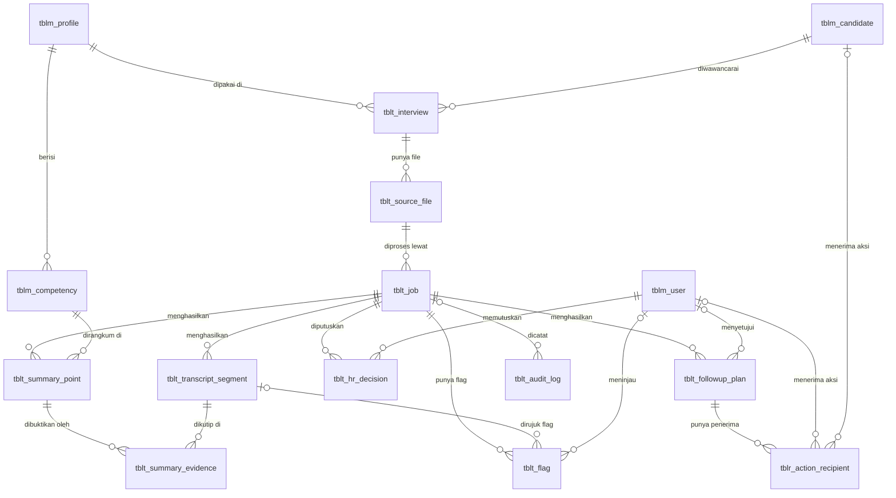
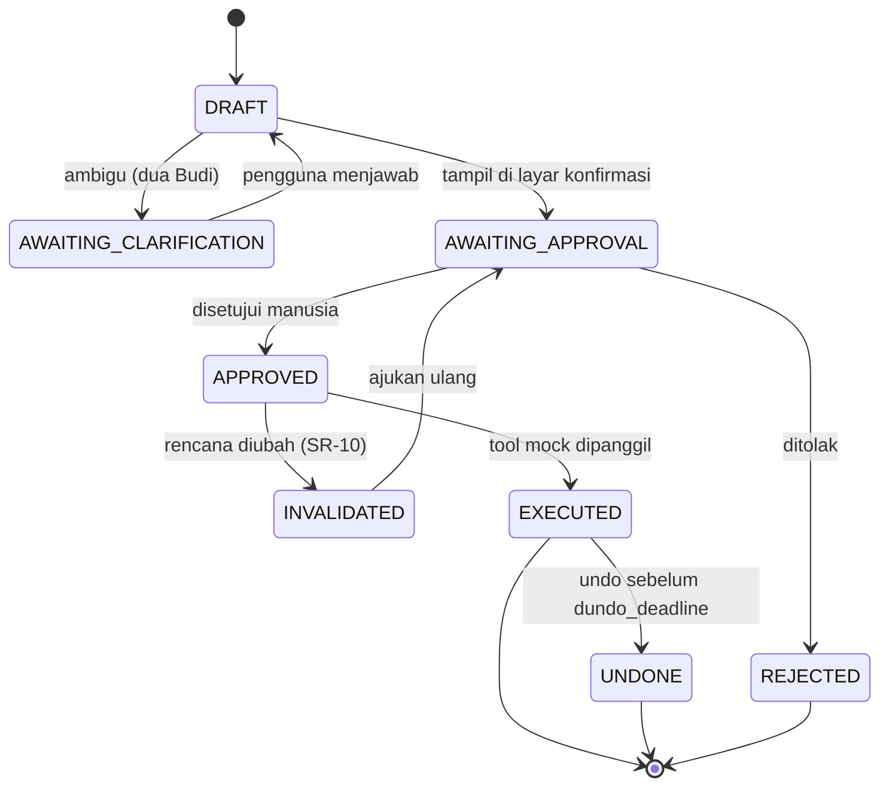
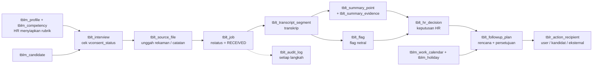

# Relational Schema — Interview Copilot

Dokumen ini menjelaskan relational schema database **Interview Copilot** (Tencent Cloud Hackathon Indonesia 2026 · Challenge B · Meeting to Action). Dasar awalnya adalah diagram [`Relational Schema.png`](./Relational%20Schema.png), lalu **direvisi** agar memenuhi seluruh kebutuhan [`SDD-Interview-Copilot.md`](./rule/SDD-Interview-Copilot.md) dan layar prototipe di [`prototype/`](./prototype/README.md).

> [!IMPORTANT]
> Dokumen ini adalah **schema revisi (v2)**. Kolom dan tabel yang belum ada di diagram PNG diberi penanda **(baru)**, sedangkan yang diubah diberi penanda **(diubah)**. Daftar lengkap perubahan ada di bagian 8. Perbarui diagram PNG agar sesuai dengan dokumen ini.

---

## Daftar isi

1. Konvensi penamaan
2. Gambaran umum dan ERD
3. Penjelasan tiap tabel
4. Ringkasan relasi (foreign key)
5. Constraint, enum, dan aturan integritas
6. Alur data dari awal sampai akhir
7. Pemetaan ke layar prototipe
8. Changelog revisi (dari diagram PNG ke v2)

---

## 1. Konvensi penamaan

### 1.1 Prefix tabel

| Prefix  | Arti                                                            | Contoh                                                           |
| ------- | --------------------------------------------------------------- | ---------------------------------------------------------------- |
| `tblm_` | **Master**: data acuan yang jarang berubah dan dipakai berulang | `tblm_user`, `tblm_candidate`, `tblm_profile`, `tblm_competency` |
| `tblt_` | **Transaksi**: data yang muncul setiap ada proses wawancara     | `tblt_interview`, `tblt_job`, `tblt_summary_point`               |
| `tblr_` | **Relasi**: tabel penghubung (many-to-many)                     | `tblr_action_recipient`                                          |
| `tbl_`  | **Sistem**: data teknis aplikasi                                | `tbl_log_system`                                                 |

### 1.2 Prefix kolom (tipe data)

| Prefix | Tipe data                                 | Contoh                                |
| ------ | ----------------------------------------- | ------------------------------------- |
| `n`    | Integer (termasuk ID dan flag 0/1)        | `nid`, `nstatus`, `nis_uncertain`     |
| `v`    | Varchar / teks                            | `vname`, `vemail`, `vquote`           |
| `d`    | Date / datetime                           | `dcrea`, `dscheduled_start_utc`       |
| `t`    | Time (jam saja, tanpa tanggal) **(baru)** | `twork_start`, `tfriday_prayer_start` |
| `f`    | Float / desimal                           | `fconfidence`                         |

### 1.3 Kolom standar

| Kolom     | Arti                                           |
| --------- | ---------------------------------------------- |
| `nid`     | Primary key (PK) setiap tabel                  |
| `nid_xxx` | Foreign key (FK) ke kolom `nid` di tabel `xxx` |
| `vcrea`   | Dibuat oleh (user ID / nama pembuat)           |
| `dcrea`   | Waktu dibuat                                   |
| `vmodi`   | Terakhir diubah oleh                           |
| `dmodi`   | Waktu terakhir diubah                          |

Semua tabel memakai keempat kolom jejak di atas, **kecuali** tabel append-only (`tbl_log_system` dan `tblt_audit_log`) yang hanya memakai `dcrea` karena barisnya tidak boleh diubah.

---

## 2. Gambaran umum dan ERD

Schema revisi terdiri dari **19 tabel** (13 dari diagram PNG + 6 tabel baru) yang terbagi dalam 7 kelompok:

| Kelompok                     | Tabel                                                                                                | Fungsi                                                                          |
| ---------------------------- | ---------------------------------------------------------------------------------------------------- | ------------------------------------------------------------------------------- |
| Pengguna, kandidat, dan izin | `tblm_user`, `tblm_candidate`, `tblm_permission` **(baru)**                                          | Siapa yang memakai sistem, siapa yang diwawancarai, dan siapa boleh melihat apa |
| Rubrik                       | `tblm_profile`, `tblm_competency`                                                                    | Profil ronde dan daftar kompetensi yang disetujui HR                            |
| Kalender                     | `tblm_work_calendar` **(baru)**, `tblm_holiday` **(baru)**                                           | Jam kerja, blok salat Jumat, dan hari libur untuk Penjadwal                     |
| Wawancara dan pemrosesan     | `tblt_interview`, `tblt_source_file`, `tblt_job`, `tblt_transcript_segment`                          | Data wawancara, file input, job pemrosesan, dan transkrip                       |
| Ringkasan, bukti, dan review | `tblt_summary_point`, `tblt_summary_evidence`, `tblt_flag` **(baru)**, `tblt_hr_decision` **(baru)** | Ringkasan per kompetensi, kutipan bukti, flag, dan keputusan HR                 |
| Tindak lanjut                | `tblt_followup_plan`, `tblr_action_recipient`                                                        | Rencana aksi (email, kalender, tugas), persetujuan, dan penerimanya             |
| Log                          | `tblt_audit_log` **(baru)**, `tbl_log_system`                                                        | Log audit berantai hash dan log teknis aplikasi                                 |



Tabel `tblm_permission`, `tblm_work_calendar`, `tblm_holiday`, dan `tbl_log_system` tidak memiliki FK. Keterkaitannya bersifat logis (lihat penjelasan masing-masing tabel).

> [!NOTE]
> Nama tabel di pojok kanan atas diagram PNG terpotong. Berdasarkan kolomnya (`vcode`, `vname`, `vversion_no`, `vsummary_format`) dan FK `nid_profile` yang merujuk ke tabel itu, dokumen ini mengasumsikan namanya **`tblm_profile`** (profil ronde). Sesuaikan bila nama aslinya berbeda.

---

## 3. Penjelasan tiap tabel

### 3.1 `tblm_user` — Pengguna sistem

Menyimpan akun internal yang memakai Interview Copilot: HR, pewawancara user, pewawancara teknis, dan auditor. Tabel ini juga berfungsi sebagai **daftar kontak** untuk penerima tindak lanjut (misalnya Budi Santoso dan Budi Hartono di skenario uji).

| Kolom                              | Tipe    | Keterangan                                                                                           |
| ---------------------------------- | ------- | ---------------------------------------------------------------------------------------------------- |
| `nid`                              | PK      | ID internal user                                                                                     |
| `vuserid`                          | varchar | Kode user yang terlihat (misalnya `C-01`, `C-02`). `UNIQUE`                                          |
| `vname`                            | varchar | Nama lengkap                                                                                         |
| `vusername`                        | varchar | Username untuk login. `UNIQUE`                                                                       |
| `vemail`                           | varchar | Email, dipakai sebagai alamat penerima aksi email. `UNIQUE`                                          |
| `vpassword_hash`                   | varchar | **(diubah, dari `vpassword`)** Hash password (bcrypt / argon2). Password asli tidak pernah disimpan  |
| `vposition`                        | varchar | Jabatan, dipakai sebagai pembeda saat klarifikasi ("Pak Budi yang mana?")                            |
| `vdepartment`                      | varchar | Departemen                                                                                           |
| `vrole`                            | varchar | **(baru)** Peran untuk kontrol akses: `HR`, `USER_INTERVIEWER`, `TECH_INTERVIEWER`, `AUDITOR` (F-14) |
| `vtimezone`                        | varchar | **(baru)** Zona waktu kontak: `WIB`, `WITA`, `WIT`. Dipakai Penjadwal (F-10)                         |
| `vstatus`                          | varchar | Status akun: `ACTIVE` atau `INACTIVE`                                                                |
| `vuser_token`                      | varchar | Token sesi / autentikasi                                                                             |
| `vcrea`, `dcrea`, `vmodi`, `dmodi` | audit   | Kolom jejak standar                                                                                  |

Relasi: dirujuk oleh `tblr_action_recipient.nid_user`, `tblt_followup_plan.nid_approved_by`, `tblt_hr_decision.nid_decided_by`, dan `tblt_flag.nid_reviewed_by`.

---

### 3.2 `tblm_candidate` — Kandidat

Menyimpan data kandidat yang diwawancarai. Sesuai SDD (D-03), agent hanya melihat `vcandidate_code` (misalnya `K-014`), bukan nama asli.

| Kolom                              | Tipe    | Keterangan                                                                                      |
| ---------------------------------- | ------- | ----------------------------------------------------------------------------------------------- |
| `nid`                              | PK      | ID internal kandidat                                                                            |
| `vcandidate_code`                  | varchar | Kode pseudonim kandidat (`K-014`), dipakai agent sebagai pengganti nama. `UNIQUE`               |
| `vname`                            | varchar | Nama asli, hanya ditampilkan di UI untuk pengguna yang berhak                                   |
| `vemail`                           | varchar | Email kandidat                                                                                  |
| `vphone_number`                    | varchar | Nomor telepon                                                                                   |
| `vjob_position`                    | varchar | Posisi yang dilamar (misalnya Operations Analyst)                                               |
| `ncurrent_salary`                  | integer | Gaji saat ini (**data sensitif**, hanya HR, lihat 5.4)                                          |
| `nexpected_salary`                 | integer | Ekspektasi gaji (**data sensitif**, hanya HR, tidak boleh bocor ke pewawancara user, lihat 5.4) |
| `vcrea`, `dcrea`, `vmodi`, `dmodi` | audit   | Kolom jejak standar                                                                             |

Relasi: dirujuk oleh `tblt_interview.nid_candidate` dan `tblr_action_recipient.nid_candidate`.

---

### 3.3 `tblm_permission` — Tabel izin **(baru)**

Tabel izin yang dipakai lapisan akses **sebelum** agent membaca data (F-14, SR-04). Menentukan peran mana yang boleh membaca kelas data tertentu.

| Kolom                              | Tipe    | Keterangan                                                                                                                                 |
| ---------------------------------- | ------- | ------------------------------------------------------------------------------------------------------------------------------------------ |
| `nid`                              | PK      | ID izin                                                                                                                                    |
| `vrole`                            | varchar | Peran (nilai sama dengan `tblm_user.vrole`)                                                                                                |
| `vvisibility_class`                | varchar | Kelas data (nilai sama dengan `tblm_competency.vvisibility_class`), misalnya `GENERAL`, `HR_ONLY`, `SALARY`, `SENSITIVE_FLAG`, `AUDIT_LOG` |
| `vaccess_level`                    | varchar | Tingkat akses: `READ`, `WRITE`, `NONE`                                                                                                     |
| `vcrea`, `dcrea`, `vmodi`, `dmodi` | audit   | Kolom jejak standar                                                                                                                        |

Kombinasi `vrole` + `vvisibility_class` bersifat `UNIQUE`. Bila kombinasi tidak ditemukan, lapisan akses menganggapnya `NONE` (_deny by default_). Contoh isi mengikuti tabel SDD 6.3:

| `vrole`            | `vvisibility_class` | `vaccess_level` |
| ------------------ | ------------------- | --------------- |
| `HR`               | `SALARY`            | `READ`          |
| `USER_INTERVIEWER` | `GENERAL`           | `READ`          |
| `USER_INTERVIEWER` | `SALARY`            | `NONE`          |
| `AUDITOR`          | `AUDIT_LOG`         | `READ`          |

---

### 3.4 `tblm_profile` — Profil ronde (rubrik berversi)

Konfigurasi satu ronde wawancara (HR, user, atau teknis). Setiap perubahan rubrik menghasilkan versi baru sehingga ringkasan lama tetap merujuk versi lamanya (F-01).

| Kolom                              | Tipe    | Keterangan                                                                                |
| ---------------------------------- | ------- | ----------------------------------------------------------------------------------------- |
| `nid`                              | PK      | ID profil                                                                                 |
| `vcode`                            | varchar | Kode profil (misalnya `HR-ROUND`, `USER-ROUND`)                                           |
| `vname`                            | varchar | Nama ronde (misalnya "Ronde HR")                                                          |
| `vversion_no`                      | varchar | Nomor versi rubrik (misalnya `v1.2`). Kombinasi `vcode` + `vversion_no` bersifat `UNIQUE` |
| `vsummary_format`                  | JSONOB  | Format / template ringkasan yang dipakai Summarizer                                       |
| `vcrea`, `dcrea`, `vmodi`, `dmodi` | audit   | Kolom jejak standar                                                                       |

Relasi: dirujuk oleh `tblm_competency.nid_profile` dan `tblt_interview.nid_profile`.

Note : untuk kolom `vsummary_format` menjawab pertanyaan hasil rangkumannya mau ditulis dengan gaya seperti apa untuk ronde ini. Kolomnya bisa berisi pengaturan seperti ini (JSON atau teks):

```
{
  "language": "id",
  "max_points_per_competency": 3,
  "include_reference_question": false,
  "not_discussed_label": "Tidak dibahas dalam wawancara ini"
}
```

---

### 3.5 `tblm_competency` — Kompetensi rubrik

Daftar kompetensi dalam satu profil ronde, misalnya C1 Motivasi, C2 Pengalaman relevan, C3 Ketersediaan dan ekspektasi, C4 Cara bekerja sama. Agent tidak boleh menambah kriteria di luar tabel ini (BR-06).

| Kolom                              | Tipe    | Keterangan                                                                                                                                                                                             |
| ---------------------------------- | ------- | ------------------------------------------------------------------------------------------------------------------------------------------------------------------------------------------------------ |
| `nid`                              | PK      | ID kompetensi                                                                                                                                                                                          |
| `vvisibility_class`                | varchar | Kelas visibilitas: dicocokkan dengan `tblm_permission` untuk menentukan peran yang boleh melihat ringkasan kompetensi ini (misalnya C3 Ekspektasi gaji = `SALARY`). Dipakai lapisan akses (F-07, F-14) |
| `vcode`                            | varchar | Kode kompetensi (`C1`, `C2`, ...). `UNIQUE` per profil                                                                                                                                                 |
| `vname`                            | varchar | Nama kompetensi                                                                                                                                                                                        |
| `nsort_order`                      | integer | Urutan tampil di ringkasan                                                                                                                                                                             |
| `vreference_question`              | varchar | Pertanyaan acuan untuk kompetensi ini                                                                                                                                                                  |
| `nid_profile`                      | FK      | Profil ronde pemilik kompetensi ini → `tblm_profile.nid`                                                                                                                                               |
| `vcrea`, `dcrea`, `vmodi`, `dmodi` | audit   | Kolom jejak standar                                                                                                                                                                                    |

---

### 3.6 `tblm_work_calendar` — Kalender kerja kantor **(baru)**

Konfigurasi jam kerja dan blok salat Jumat per kantor. Dibaca oleh Penjadwal yang berlogika tetap (F-10, SR-06, SDD 7.8).

| Kolom                              | Tipe    | Keterangan                                           |
| ---------------------------------- | ------- | ---------------------------------------------------- |
| `nid`                              | PK      | ID kalender kerja                                    |
| `voffice_code`                     | varchar | Kode kantor (misalnya `JKT`, `MKS`). `UNIQUE`        |
| `vtimezone`                        | varchar | Zona waktu kantor: `WIB`, `WITA`, `WIT`              |
| `twork_start`                      | time    | Jam mulai kerja (waktu setempat), misalnya `08:00`   |
| `twork_end`                        | time    | Jam selesai kerja (waktu setempat), misalnya `17:00` |
| `tfriday_prayer_start`             | time    | Awal blok salat Jumat, usulan awal `11:30`           |
| `tfriday_prayer_end`               | time    | Akhir blok salat Jumat, usulan awal `13:00`          |
| `vcrea`, `dcrea`, `vmodi`, `dmodi` | audit   | Kolom jejak standar                                  |

---

### 3.7 `tblm_holiday` — Hari libur **(baru)**

Daftar hari libur nasional dan cuti bersama. Diperbarui HR di luar run (SDD 7.8).

| Kolom                              | Tipe    | Keterangan                                                       |
| ---------------------------------- | ------- | ---------------------------------------------------------------- |
| `nid`                              | PK      | ID hari libur                                                    |
| `dholiday_date`                    | date    | Tanggal libur. `UNIQUE`                                          |
| `vname`                            | varchar | Nama hari libur (misalnya "Hari Kemerdekaan RI")                 |
| `vtype`                            | varchar | Jenis: `NATIONAL_HOLIDAY` atau `COLLECTIVE_LEAVE` (cuti bersama) |
| `vcrea`, `dcrea`, `vmodi`, `dmodi` | audit   | Kolom jejak standar                                              |

---

### 3.8 `tblt_interview` — Sesi wawancara

Satu baris untuk satu sesi wawancara seorang kandidat pada satu ronde. Tabel ini menjadi titik pusat yang menghubungkan kandidat, profil ronde, dan file input.

| Kolom                              | Tipe     | Keterangan                                                                                                                                  |
| ---------------------------------- | -------- | ------------------------------------------------------------------------------------------------------------------------------------------- |
| `nid`                              | PK       | ID wawancara                                                                                                                                |
| `vconsent_status`                  | varchar  | Status persetujuan kandidat: `GRANTED`, `NOT_GRANTED`, `WITHDRAWN`. Jika bukan `GRANTED`, job ditolak (BR-08, status `REJECTED_NO_CONSENT`) |
| `dconsent_at`                      | datetime | **(baru)** Waktu persetujuan diberikan (SDD 7.2)                                                                                            |
| `vconsent_notice_version`          | varchar  | **(baru)** Versi teks pemberitahuan yang disetujui kandidat (SDD 7.2)                                                                       |
| `nid_profile`                      | FK       | Profil ronde yang dipakai → `tblm_profile.nid`                                                                                              |
| `nid_candidate`                    | FK       | **(diubah, typo dari `nid_canidate`)** Kandidat yang diwawancarai → `tblm_candidate.nid`                                                    |
| `vcrea`, `dcrea`, `vmodi`, `dmodi` | audit    | **(baru)** Kolom jejak standar                                                                                                              |

---

### 3.9 `tblt_source_file` — File input wawancara

Menyimpan file sumber yang diunggah: rekaman audio, video, transkrip teks, atau catatan manual.

| Kolom                              | Tipe    | Keterangan                                                     |
| ---------------------------------- | ------- | -------------------------------------------------------------- |
| `nid`                              | PK      | ID file                                                        |
| `vtype`                            | varchar | Jenis file: `AUDIO`, `VIDEO`, `TRANSCRIPT_TEXT`, `MANUAL_NOTE` |
| `vurl`                             | varchar | Lokasi penyimpanan file (URL / path object storage)            |
| `vduration`                        | varchar | Durasi rekaman                                                 |
| `nid_interview`                    | FK      | Wawancara pemilik file → `tblt_interview.nid`                  |
| `vcrea`, `dcrea`, `vmodi`, `dmodi` | audit   | Kolom jejak standar                                            |

---

### 3.10 `tblt_job` — Job pemrosesan

Satu proses pengolahan sebuah file wawancara oleh pipeline (transkripsi, ringkasan, audit, perencanaan). Job inilah yang berpindah status sesuai SDD bagian 5.6.

| Kolom                              | Tipe    | Keterangan                                                                                                   |
| ---------------------------------- | ------- | ------------------------------------------------------------------------------------------------------------ |
| `nid`                              | PK      | ID job                                                                                                       |
| `vasr_engine`                      | varchar | Mesin ASR (Automatic Speech Recognition) yang dipakai untuk transkripsi                                      |
| `vasr_model_version`               | varchar | Versi model ASR, penting untuk menelusuri kualitas transkrip                                                 |
| `vlanguage_code`                   | varchar | Bahasa input: `id`, `en`, atau `mixed`                                                                       |
| `nstatus`                          | integer | Status job, dikodekan sebagai angka (lihat tabel di bawah)                                                   |
| `nid_source`                       | FK      | File yang menjadi input → `tblt_source_file.nid`. Wawancara diperoleh lewat `tblt_source_file.nid_interview` |
| `vcrea`, `dcrea`, `vmodi`, `dmodi` | audit   | Kolom jejak standar                                                                                          |

> [!NOTE]
> Kolom `nid_interview` **dihapus** dari `tblt_job` karena redundan: wawancara sudah dapat ditelusuri lewat `nid_source → tblt_source_file.nid_interview`. Ini mencegah job merujuk wawancara yang berbeda dari file sumbernya.

Kode `nstatus` (mengikuti SDD 5.6):

| Kode | Status                 |
| ---- | ---------------------- |
| 1    | RECEIVED               |
| 2    | ACCESS_CHECKED         |
| 3    | TRANSCRIBED            |
| 4    | SUMMARIZED             |
| 5    | AUDITED                |
| 6    | IN_REVIEW              |
| 7    | PLANNED                |
| 8    | AWAITING_CLARIFICATION |
| 9    | AWAITING_APPROVAL      |
| 10   | EXECUTED_MOCK          |
| 90   | REJECTED_NO_CONSENT    |
| 91   | DENIED                 |
| 92   | CANCELLED              |
| 93   | ESCALATED              |

---

### 3.11 `tblt_transcript_segment` — Segmen transkrip

Hasil transkripsi yang dipecah per segmen. Setiap segmen punya penanda waktu sehingga bisa dikutip sebagai bukti (F-03).

| Kolom                              | Tipe    | Keterangan                                                                                                     |
| ---------------------------------- | ------- | -------------------------------------------------------------------------------------------------------------- |
| `nid`                              | PK      | ID segmen                                                                                                      |
| `nsegment_no`                      | integer | Nomor urut segmen (misalnya `71` untuk `seg-0071`). `UNIQUE` per job                                           |
| `nstart_ms`                        | integer | Waktu mulai dalam milidetik                                                                                    |
| `nend_ms`                          | integer | Waktu selesai dalam milidetik. Wajib `>= nstart_ms`                                                            |
| `vspeaker_label`                   | varchar | Label pembicara dari ASR (misalnya `SPEAKER_1`)                                                                |
| `vspeaker_type`                    | varchar | Jenis pembicara: `CANDIDATE`, `INTERVIEWER`, `UNKNOWN`. Segmen `UNKNOWN` tidak boleh diatribusikan ke kandidat |
| `vtext`                            | varchar | Isi ucapan                                                                                                     |
| `fconfidence`                      | float   | Tingkat keyakinan ASR (0 sampai 1)                                                                             |
| `nis_uncertain`                    | integer | Penanda segmen tidak yakin (1 = ya). Segmen ini tidak dipakai sebagai dasar kesimpulan                         |
| `nid_job`                          | FK      | Job yang menghasilkan segmen → `tblt_job.nid`                                                                  |
| `vcrea`, `dcrea`, `vmodi`, `dmodi` | audit   | Kolom jejak standar (**`dmodi` baru**)                                                                         |

---

### 3.12 `tblt_summary_point` — Poin ringkasan

Ringkasan jawaban kandidat per kompetensi. Tidak boleh ada skor atau kata evaluatif (BR-01 sampai BR-04).

| Kolom                              | Tipe    | Keterangan                                                                                                       |
| ---------------------------------- | ------- | ---------------------------------------------------------------------------------------------------------------- |
| `nid`                              | PK      | ID poin ringkasan                                                                                                |
| `vcoverage_status`                 | varchar | Cakupan topik: `COVERED`, `PARTIAL`, `NOT_DISCUSSED` (BR-03)                                                     |
| `vcontent`                         | varchar | Isi poin ringkasan (deskriptif, netral)                                                                          |
| `vverification_status`             | varchar | Hasil Auditor: `VERIFIED`, `UNVERIFIED`, `NOT_APPLICABLE` (untuk poin `NOT_DISCUSSED`) (F-05)                    |
| `nid_competency`                   | FK      | Kompetensi yang dirangkum → `tblm_competency.nid`                                                                |
| `nid_job`                          | FK      | Job yang menghasilkan ringkasan → `tblt_job.nid`                                                                 |
| `vcrea`, `dcrea`, `vmodi`, `dmodi` | audit   | Kolom jejak standar. `vmodi` / `dmodi` juga merekam edit oleh HR (F-08), detail edit dicatat di `tblt_audit_log` |

---

### 3.13 `tblt_summary_evidence` — Bukti kutipan

Menghubungkan poin ringkasan dengan segmen transkrip yang menjadi buktinya. Satu poin bisa punya lebih dari satu kutipan. Tabel ini yang menjamin aturan **"100% poin punya kutipan dan penanda waktu"** (G-02).

| Kolom                              | Tipe    | Keterangan                                                                                                         |
| ---------------------------------- | ------- | ------------------------------------------------------------------------------------------------------------------ |
| `nid`                              | PK      | ID bukti                                                                                                           |
| `vquote`                           | varchar | Kutipan persis dari transkrip. Auditor memeriksa bahwa teks ini benar-benar ada di `tblt_transcript_segment.vtext` |
| `nid_transcript`                   | FK      | Segmen yang dikutip → `tblt_transcript_segment.nid` (penanda waktu diambil dari segmen ini)                        |
| `nid_summary_point`                | FK      | Poin yang didukung → `tblt_summary_point.nid`                                                                      |
| `vcrea`, `dcrea`, `vmodi`, `dmodi` | audit   | Kolom jejak standar                                                                                                |

---

### 3.14 `tblt_flag` — Flag untuk HR **(baru)**

Penanda hal yang perlu perhatian manusia, ditulis netral tanpa tuduhan (F-06, F-15, SDD 7.5). Menggantikan kolom `vflag` di `tblt_transcript_segment`.

| Kolom                              | Tipe     | Keterangan                                                                                                               |
| ---------------------------------- | -------- | ------------------------------------------------------------------------------------------------------------------------ |
| `nid`                              | PK       | ID flag                                                                                                                  |
| `vflag_type`                       | varchar  | Jenis flag: `NEEDS_CLARIFICATION`, `SENSITIVE_ATTRIBUTE`, `UNCERTAIN_SEGMENT`, `EMBEDDED_INSTRUCTION`                    |
| `vneutral_text`                    | varchar  | Teks netral, misalnya "Pada 12:40 kandidat menyebut 3 tahun pengalaman, pada 31:05 menyebut 5 tahun. Perlu klarifikasi." |
| `vstatus`                          | varchar  | Status tinjauan: `OPEN`, `REVIEWED`                                                                                      |
| `nid_job`                          | FK       | Job asal flag → `tblt_job.nid`                                                                                           |
| `nid_transcript`                   | FK       | Segmen yang dirujuk → `tblt_transcript_segment.nid` (boleh kosong untuk flag lintas ronde)                               |
| `nid_reviewed_by`                  | FK       | HR yang meninjau → `tblm_user.nid` (kosong selama `OPEN`)                                                                |
| `dreviewed_at`                     | datetime | Waktu ditinjau                                                                                                           |
| `vcrea`, `dcrea`, `vmodi`, `dmodi` | audit    | Kolom jejak standar                                                                                                      |

Flag `SENSITIVE_ATTRIBUTE` memakai kelas visibilitas `SENSITIVE_FLAG` di lapisan akses: hanya HR yang membaca isinya, auditor hanya melihat jumlahnya (SDD 6.3).

---

### 3.15 `tblt_hr_decision` — Keputusan HR **(baru)**

Mencatat keputusan yang dibuat **manusia** setelah review (F-08, BR-01). Agent tidak pernah menulis ke tabel ini.

| Kolom                              | Tipe     | Keterangan                                                             |
| ---------------------------------- | -------- | ---------------------------------------------------------------------- |
| `nid`                              | PK       | ID keputusan                                                           |
| `vdecision`                        | varchar  | Keputusan HR: `PROCEED`, `HOLD`, `REJECT`                              |
| `vnote`                            | varchar  | Catatan HR (opsional)                                                  |
| `vsummary_hash`                    | varchar  | Hash ringkasan yang direview saat keputusan dibuat ("versi ringkasan") |
| `nid_job`                          | FK       | Job / wawancara yang diputuskan → `tblt_job.nid`                       |
| `nid_decided_by`                   | FK       | HR yang memutuskan → `tblm_user.nid`                                   |
| `ddecided_at`                      | datetime | Waktu keputusan                                                        |
| `vcrea`, `dcrea`, `vmodi`, `dmodi` | audit    | Kolom jejak standar                                                    |

---

### 3.16 `tblt_followup_plan` — Rencana tindak lanjut

Aksi diskrit hasil pemecahan instruksi HR, misalnya "kirim ringkasan ke Pak Budi, lalu jadwalkan ronde user Jumat siang" (F-09, F-10). Setiap aksi memuat **siapa** (lewat `tblr_action_recipient`), **apa**, **kapan**, dan **di mana**, serta status persetujuannya.

| Kolom                              | Tipe     | Keterangan                                                                                                                                    |
| ---------------------------------- | -------- | --------------------------------------------------------------------------------------------------------------------------------------------- |
| `nid`                              | PK       | ID rencana / aksi                                                                                                                             |
| `vplan`                            | varchar  | Isi lengkap aksi (isi email, judul undangan, deskripsi tugas)                                                                                 |
| `vaction_type`                     | varchar  | Jenis aksi: `EMAIL`, `CALENDAR`, `TASK`                                                                                                       |
| `dscheduled_start_utc`             | datetime | Waktu mulai, disimpan dalam **UTC** lalu dikonversi ke WIB / WITA / WIT saat ditampilkan                                                      |
| `dscheduled_end_utc`               | datetime | Waktu selesai (UTC). Wajib `>= dscheduled_start_utc`                                                                                          |
| `vlocation`                        | varchar  | **(baru)** Lokasi atau tautan meeting ("di mana", SDD 7.6)                                                                                    |
| `vimpact_level`                    | varchar  | **(baru)** Tingkat dampak: `NORMAL` atau `HIGH`. `HIGH` (banyak penerima, email eksternal, pembayaran) mewajibkan konfirmasi tambahan (SR-09) |
| `vapproval_status`                 | varchar  | **(baru)** Status persetujuan (lihat 5.2)                                                                                                     |
| `vplan_hash`                       | varchar  | **(baru)** Hash isi rencana (isi + waktu + lokasi + daftar penerima). Persetujuan terikat pada hash ini                                       |
| `vapproval_token`                  | varchar  | **(baru)** Tanda persetujuan yang diterbitkan gerbang persetujuan. Tool mock menolak panggilan tanpa token valid (F-13)                       |
| `nid_approved_by`                  | FK       | **(baru)** Manusia yang menyetujui → `tblm_user.nid`                                                                                          |
| `dapproved_at`                     | datetime | **(baru)** Waktu persetujuan                                                                                                                  |
| `vmock_result_id`                  | varchar  | **(baru)** ID hasil eksekusi tool mock (F-13)                                                                                                 |
| `dexecuted_at`                     | datetime | **(baru)** Waktu eksekusi mock                                                                                                                |
| `dundo_deadline`                   | datetime | **(baru)** Batas undo, yaitu `dexecuted_at + 60 detik` (B-04)                                                                                 |
| `nid_job`                          | FK       | Job asal rencana → `tblt_job.nid`                                                                                                             |
| `vcrea`, `dcrea`, `vmodi`, `dmodi` | audit    | Kolom jejak standar                                                                                                                           |

> [!IMPORTANT]
> **Aturan SR-10**: setiap perubahan pada `vplan`, waktu, `vlocation`, atau penerima akan mengubah `vplan_hash`. Jika hash berbeda dari saat disetujui, `vapproval_status` otomatis menjadi `INVALIDATED` dan `vapproval_token` dikosongkan, sehingga rencana harus disetujui ulang.

---

### 3.17 `tblr_action_recipient` — Penerima aksi

Tabel penghubung **many-to-many** antara rencana tindak lanjut dan penerimanya. Penerima bisa berupa user internal, kandidat, **atau** alamat email eksternal (misalnya vendor).

| Kolom                              | Tipe    | Keterangan                                                                                            |
| ---------------------------------- | ------- | ----------------------------------------------------------------------------------------------------- |
| `nid`                              | PK      | ID baris penerima                                                                                     |
| `nid_candidate`                    | FK      | **(diubah, typo dari `nid_canidate`)** Penerima berupa kandidat → `tblm_candidate.nid` (boleh kosong) |
| `nid_user`                         | FK      | Penerima berupa user internal → `tblm_user.nid` (boleh kosong)                                        |
| `vexternal_email`                  | varchar | **(baru)** Penerima eksternal di luar sistem, misalnya email vendor di Skenario 9 (boleh kosong)      |
| `vrecipient_role`                  | varchar | **(baru)** Peran penerima: `TO`, `CC`, `ATTENDEE`                                                     |
| `nid_followup_plan`                | FK      | Aksi terkait → `tblt_followup_plan.nid`                                                               |
| `vcrea`, `dcrea`, `vmodi`, `dmodi` | audit   | Kolom jejak standar                                                                                   |

Constraint: **tepat satu** dari `nid_user`, `nid_candidate`, atau `vexternal_email` wajib terisi (lihat 5.3). Aksi dengan banyak penerima atau penerima eksternal otomatis ditandai `vimpact_level = HIGH` (SR-09).

---

### 3.18 `tblt_audit_log` — Log audit berantai hash **(baru)**

Log audit **append-only** yang ditulis orkestrator (F-16, SR-07, NFR-04). Berbeda dengan `tbl_log_system` yang berisi log teknis, tabel ini mencatat kejadian bisnis: diminta → diproses → disetujui → dijalankan. Dipakai layar S7.

| Kolom            | Tipe     | Keterangan                                                                                                                                                                                                                                     |
| ---------------- | -------- | ---------------------------------------------------------------------------------------------------------------------------------------------------------------------------------------------------------------------------------------------- |
| `nid`            | PK       | ID kejadian (berurutan)                                                                                                                                                                                                                        |
| `nid_job`        | FK       | Job terkait → `tblt_job.nid` (boleh kosong untuk kejadian di luar job, misalnya akses ditolak)                                                                                                                                                 |
| `vactor_type`    | varchar  | Pelaku: `ORCHESTRATOR`, `AGENT`, `HUMAN`                                                                                                                                                                                                       |
| `vactor_id`      | varchar  | Identitas pelaku (user ID atau nama komponen, misalnya `summarizer`)                                                                                                                                                                           |
| `vevent_type`    | varchar  | Jenis kejadian, misalnya `INPUT_RECEIVED`, `CONSENT_CHECKED`, `ACCESS_DENIED`, `SUMMARY_AUDITED`, `FLAG_RAISED`, `HR_DECISION`, `PLAN_CREATED`, `CLARIFICATION_ASKED`, `PLAN_APPROVED`, `APPROVAL_INVALIDATED`, `MOCK_EXECUTED`, `MOCK_UNDONE` |
| `vpayload_hash`  | varchar  | Hash isi kejadian (isi asli tidak disimpan di sini)                                                                                                                                                                                            |
| `vmasked_detail` | varchar  | Ringkasan kejadian dengan data sensitif dimasking (NFR-06)                                                                                                                                                                                     |
| `vprev_hash`     | varchar  | Hash kejadian sebelumnya (rantai bukti)                                                                                                                                                                                                        |
| `vhash`          | varchar  | Hash kejadian ini = hash(`vprev_hash` + `vpayload_hash` + `vevent_type` + `dcrea`)                                                                                                                                                             |
| `dcrea`          | datetime | Waktu kejadian. Tidak ada `vmodi` / `dmodi` karena append-only                                                                                                                                                                                 |

Database user aplikasi hanya diberi izin `INSERT` dan `SELECT` pada tabel ini (tanpa `UPDATE` / `DELETE`). Jika penulisan log gagal, job dihentikan (F-16).

---

### 3.19 `tbl_log_system` — Log sistem

Log teknis aplikasi (error, request API, debugging). Tabel ini berdiri sendiri tanpa relasi dan **bukan** pengganti log audit.

| Kolom              | Tipe     | Keterangan                                                                    |
| ------------------ | -------- | ----------------------------------------------------------------------------- |
| `nid`              | PK       | ID log                                                                        |
| `vlog_level`       | varchar  | Level log: `INFO`, `WARN`, `ERROR`                                            |
| `vlog_message`     | varchar  | Pesan log (data sensitif wajib dimasking)                                     |
| `vlog_stacktrace`  | varchar  | Stack trace jika terjadi error                                                |
| `vlog_source`      | varchar  | Komponen asal log (orkestrator, summarizer, auditor, dll.)                    |
| `vlog_path`        | varchar  | Endpoint / path request                                                       |
| `vlog_method`      | varchar  | HTTP method (GET, POST, ...)                                                  |
| `vlog_status_code` | varchar  | HTTP status code                                                              |
| `dcrea`            | datetime | Waktu log dibuat. Tidak ada `vmodi` / `dmodi` karena log bersifat append-only |

---

## 4. Ringkasan relasi (foreign key)

| Tabel anak                | Kolom FK            | Tabel induk               | Kardinalitas | Wajib?  | Makna                                       |
| ------------------------- | ------------------- | ------------------------- | ------------ | ------- | ------------------------------------------- |
| `tblm_competency`         | `nid_profile`       | `tblm_profile`            | N : 1        | Ya      | Satu profil punya banyak kompetensi         |
| `tblt_interview`          | `nid_profile`       | `tblm_profile`            | N : 1        | Ya      | Wawancara memakai satu profil ronde         |
| `tblt_interview`          | `nid_candidate`     | `tblm_candidate`          | N : 1        | Ya      | Satu kandidat bisa ikut beberapa ronde      |
| `tblt_source_file`        | `nid_interview`     | `tblt_interview`          | N : 1        | Ya      | Satu wawancara bisa punya beberapa file     |
| `tblt_job`                | `nid_source`        | `tblt_source_file`        | N : 1        | Ya      | Job memproses satu file sumber              |
| `tblt_transcript_segment` | `nid_job`           | `tblt_job`                | N : 1        | Ya      | Satu job menghasilkan banyak segmen         |
| `tblt_summary_point`      | `nid_job`           | `tblt_job`                | N : 1        | Ya      | Satu job menghasilkan banyak poin ringkasan |
| `tblt_summary_point`      | `nid_competency`    | `tblm_competency`         | N : 1        | Ya      | Poin merangkum satu kompetensi              |
| `tblt_summary_evidence`   | `nid_summary_point` | `tblt_summary_point`      | N : 1        | Ya      | Satu poin punya satu atau lebih kutipan     |
| `tblt_summary_evidence`   | `nid_transcript`    | `tblt_transcript_segment` | N : 1        | Ya      | Kutipan merujuk satu segmen                 |
| `tblt_flag`               | `nid_job`           | `tblt_job`                | N : 1        | Ya      | Satu job bisa punya banyak flag             |
| `tblt_flag`               | `nid_transcript`    | `tblt_transcript_segment` | N : 1        | Tidak   | Flag merujuk segmen tertentu                |
| `tblt_flag`               | `nid_reviewed_by`   | `tblm_user`               | N : 1        | Tidak   | HR yang meninjau flag                       |
| `tblt_hr_decision`        | `nid_job`           | `tblt_job`                | N : 1        | Ya      | Keputusan HR atas satu job                  |
| `tblt_hr_decision`        | `nid_decided_by`    | `tblm_user`               | N : 1        | Ya      | HR yang memutuskan                          |
| `tblt_followup_plan`      | `nid_job`           | `tblt_job`                | N : 1        | Ya      | Satu job bisa menghasilkan banyak aksi      |
| `tblt_followup_plan`      | `nid_approved_by`   | `tblm_user`               | N : 1        | Tidak   | Manusia yang menyetujui aksi                |
| `tblr_action_recipient`   | `nid_followup_plan` | `tblt_followup_plan`      | N : 1        | Ya      | Satu aksi punya banyak penerima             |
| `tblr_action_recipient`   | `nid_user`          | `tblm_user`               | N : 1        | Tidak\* | Penerima internal                           |
| `tblr_action_recipient`   | `nid_candidate`     | `tblm_candidate`          | N : 1        | Tidak\* | Penerima kandidat                           |
| `tblt_audit_log`          | `nid_job`           | `tblt_job`                | N : 1        | Tidak   | Kejadian audit terkait job                  |

\* Tepat satu dari `nid_user`, `nid_candidate`, atau `vexternal_email` wajib terisi.

Semua FK memakai `ON DELETE RESTRICT` agar data yang sudah tercatat di log audit tidak bisa terhapus secara berantai.

---

## 5. Constraint, enum, dan aturan integritas

### 5.1 Nilai enum (dibatasi dengan `CHECK`)

| Tabel.kolom                                                              | Nilai yang diizinkan                                                                                                |
| ------------------------------------------------------------------------ | ------------------------------------------------------------------------------------------------------------------- |
| `tblm_user.vrole`                                                        | `HR`, `USER_INTERVIEWER`, `TECH_INTERVIEWER`, `AUDITOR`                                                             |
| `tblm_user.vtimezone`, `tblm_work_calendar.vtimezone`                    | `WIB`, `WITA`, `WIT`                                                                                                |
| `tblm_user.vstatus`                                                      | `ACTIVE`, `INACTIVE`                                                                                                |
| `tblm_permission.vaccess_level`                                          | `READ`, `WRITE`, `NONE`                                                                                             |
| `tblm_competency.vvisibility_class`, `tblm_permission.vvisibility_class` | `GENERAL`, `HR_ONLY`, `SALARY`, `SENSITIVE_FLAG`, `AUDIT_LOG`                                                       |
| `tblm_holiday.vtype`                                                     | `NATIONAL_HOLIDAY`, `COLLECTIVE_LEAVE`                                                                              |
| `tblt_interview.vconsent_status`                                         | `GRANTED`, `NOT_GRANTED`, `WITHDRAWN`                                                                               |
| `tblt_source_file.vtype`                                                 | `AUDIO`, `VIDEO`, `TRANSCRIPT_TEXT`, `MANUAL_NOTE`                                                                  |
| `tblt_job.nstatus`                                                       | Kode di tabel 3.10                                                                                                  |
| `tblt_transcript_segment.vspeaker_type`                                  | `CANDIDATE`, `INTERVIEWER`, `UNKNOWN`                                                                               |
| `tblt_summary_point.vcoverage_status`                                    | `COVERED`, `PARTIAL`, `NOT_DISCUSSED`                                                                               |
| `tblt_summary_point.vverification_status`                                | `VERIFIED`, `UNVERIFIED`, `NOT_APPLICABLE`                                                                          |
| `tblt_flag.vflag_type`                                                   | `NEEDS_CLARIFICATION`, `SENSITIVE_ATTRIBUTE`, `UNCERTAIN_SEGMENT`, `EMBEDDED_INSTRUCTION`                           |
| `tblt_flag.vstatus`                                                      | `OPEN`, `REVIEWED`                                                                                                  |
| `tblt_hr_decision.vdecision`                                             | `PROCEED`, `HOLD`, `REJECT`                                                                                         |
| `tblt_followup_plan.vaction_type`                                        | `EMAIL`, `CALENDAR`, `TASK`                                                                                         |
| `tblt_followup_plan.vimpact_level`                                       | `NORMAL`, `HIGH`                                                                                                    |
| `tblt_followup_plan.vapproval_status`                                    | `DRAFT`, `AWAITING_CLARIFICATION`, `AWAITING_APPROVAL`, `APPROVED`, `REJECTED`, `INVALIDATED`, `EXECUTED`, `UNDONE` |
| `tblr_action_recipient.vrecipient_role`                                  | `TO`, `CC`, `ATTENDEE`                                                                                              |
| `tblt_audit_log.vactor_type`                                             | `ORCHESTRATOR`, `AGENT`, `HUMAN`                                                                                    |

### 5.2 Siklus status persetujuan rencana



### 5.3 Constraint penting

| Tabel                     | Constraint                                                                    | Tujuan                                                    |
| ------------------------- | ----------------------------------------------------------------------------- | --------------------------------------------------------- |
| `tblr_action_recipient`   | `CHECK` tepat satu dari `nid_user`, `nid_candidate`, `vexternal_email` terisi | Penerima selalu jelas dan tidak ganda                     |
| `tblt_followup_plan`      | `CHECK (vapproval_status <> 'EXECUTED' OR vapproval_token IS NOT NULL)`       | Tidak ada eksekusi tanpa tanda persetujuan (SR-01, SR-02) |
| `tblt_followup_plan`      | `CHECK (dscheduled_end_utc >= dscheduled_start_utc)`                          | Waktu valid                                               |
| `tblt_transcript_segment` | `CHECK (nend_ms >= nstart_ms)`, `UNIQUE (nid_job, nsegment_no)`               | Penanda waktu valid dan nomor segmen unik                 |
| `tblt_transcript_segment` | `CHECK (fconfidence BETWEEN 0 AND 1)`                                         | Rentang keyakinan valid                                   |
| `tblm_profile`            | `UNIQUE (vcode, vversion_no)`                                                 | Versi rubrik tidak ganda                                  |
| `tblm_competency`         | `UNIQUE (nid_profile, vcode)`                                                 | Kode kompetensi unik per profil                           |
| `tblm_permission`         | `UNIQUE (vrole, vvisibility_class)`                                           | Satu aturan per kombinasi                                 |
| `tblt_audit_log`          | Hanya izin `INSERT` dan `SELECT`                                              | Append-only (SR-07)                                       |

### 5.4 Keamanan data sensitif

- **Password**: hanya `vpassword_hash` (bcrypt / argon2) yang disimpan.
- **Gaji** (`ncurrent_salary`, `nexpected_salary`): aplikasi dan agent membaca kandidat lewat view `vw_candidate_public` yang **tidak** memuat kolom gaji. Tabel `tblm_candidate` secara langsung hanya bisa dibaca peran HR (bila memungkinkan, kolom gaji dienkripsi di level kolom).
- **Pseudonimisasi**: lapisan akses mengganti `vname` kandidat dengan `vcandidate_code` sebelum data dikirim ke agent (D-03).
- **Log**: `tblt_audit_log.vmasked_detail` dan `tbl_log_system.vlog_message` wajib memasking data sensitif (NFR-06).

---

## 6. Alur data dari awal sampai akhir



1. HR membuat **profil ronde** (`tblm_profile`) beserta **kompetensinya** (`tblm_competency`), dan mengatur `tblm_permission`.
2. Sesi wawancara dicatat di `tblt_interview` dengan status, waktu, dan versi pemberitahuan persetujuan kandidat.
3. File rekaman atau catatan diunggah ke `tblt_source_file`.
4. Sistem membuat `tblt_job`. Jika `vconsent_status` bukan `GRANTED`, job langsung berstatus `REJECTED_NO_CONSENT`.
5. Transkriptor mengisi `tblt_transcript_segment`, termasuk `nis_uncertain`.
6. Summarizer mengisi `tblt_summary_point` dan `tblt_summary_evidence`. Auditor memperbarui `vverification_status` dan menulis `tblt_flag`.
7. HR mereview, meninjau flag, dan mencatat keputusannya di `tblt_hr_decision`.
8. Perencana mengisi `tblt_followup_plan` dan `tblr_action_recipient`. Penjadwal memakai `tblm_user.vtimezone`, `tblm_work_calendar`, dan `tblm_holiday`.
9. Manusia menyetujui di layar konfirmasi, lalu `vapproval_token` diterbitkan dan tool mock dijalankan.
10. Setiap langkah bisnis dicatat di `tblt_audit_log`, sedangkan error teknis di `tbl_log_system`.

---

## 7. Pemetaan ke layar prototipe

| Layar                            | Fungsi                                           | Tabel utama                                                                                               |
| -------------------------------- | ------------------------------------------------ | --------------------------------------------------------------------------------------------------------- |
| **S1** Rubrik & Profil Ronde     | HR mengatur rubrik berversi                      | `tblm_profile`, `tblm_competency`                                                                         |
| **S2** Unggah & Cek Persetujuan  | Unggah input, tolak bila tanpa persetujuan       | `tblt_interview`, `tblt_source_file`, `tblt_job`                                                          |
| **S3** Review Ringkasan & Bukti  | Split-view ringkasan dan transkrip, keputusan HR | `tblt_summary_point`, `tblt_summary_evidence`, `tblt_transcript_segment`, `tblt_flag`, `tblt_hr_decision` |
| **S4** Tindak Lanjut & Penjadwal | Rencana aksi, klarifikasi penerima, cek kalender | `tblt_followup_plan`, `tblr_action_recipient`, `tblm_user`, `tblm_work_calendar`, `tblm_holiday`          |
| **S5** Konfirmasi & Persetujuan  | Penerima, waktu, isi persis, approval, undo      | `tblt_followup_plan` (kolom persetujuan dan eksekusi), `tblr_action_recipient`                            |
| **S6** Uji Kontrol Akses         | Filter data berdasarkan peran                    | `tblm_permission`, `tblm_user.vrole`, `tblm_competency.vvisibility_class`, `vw_candidate_public`          |
| **S7** Log Audit                 | Rantai hash, verifikasi, ekspor                  | `tblt_audit_log`                                                                                          |
| **S8** Penjaga Prompt Injection  | Banner instruksi tertanam                        | `tblt_flag` (`vflag_type = EMBEDDED_INSTRUCTION`)                                                         |

---

## 8. Changelog revisi (dari diagram PNG ke v2)

### 8.1 Perbaikan typo

| Tabel                   | Sebelum        | Sesudah         |
| ----------------------- | -------------- | --------------- |
| `tblt_interview`        | `nid_canidate` | `nid_candidate` |
| `tblr_action_recipient` | `nid_canidate` | `nid_candidate` |

### 8.2 Kolom yang ditambah, diubah, atau dihapus

| Tabel                     | Perubahan                                                                                                                                                                   | Alasan (SDD)                                             |
| ------------------------- | --------------------------------------------------------------------------------------------------------------------------------------------------------------------------- | -------------------------------------------------------- |
| `tblm_user`               | `vpassword` → `vpassword_hash`                                                                                                                                              | Keamanan password                                        |
| `tblm_user`               | + `vrole`, + `vtimezone`                                                                                                                                                    | F-14 kontrol akses, F-10 penjadwal zona waktu            |
| `tblt_interview`          | + `dconsent_at`, + `vconsent_notice_version`, + kolom jejak                                                                                                                 | SDD 7.2, konsistensi                                     |
| `tblt_job`                | − `nid_interview`                                                                                                                                                           | Menghapus redundansi (diturunkan lewat `nid_source`)     |
| `tblt_transcript_segment` | − `vflag` (pindah ke `tblt_flag`), + `dmodi`                                                                                                                                | F-06 flag dengan status tinjauan, konsistensi            |
| `tblt_followup_plan`      | + `vlocation`, `vimpact_level`, `vapproval_status`, `vplan_hash`, `vapproval_token`, `nid_approved_by`, `dapproved_at`, `vmock_result_id`, `dexecuted_at`, `dundo_deadline` | F-09 "di mana", SR-09, F-12, SR-10, F-13, B-04           |
| `tblr_action_recipient`   | + `vexternal_email`, + `vrecipient_role`                                                                                                                                    | Penerima eksternal (Skenario 9), peran to / cc / peserta |

### 8.3 Tabel baru

| Tabel                | Alasan (SDD)                                     |
| -------------------- | ------------------------------------------------ |
| `tblm_permission`    | F-14, SR-04, SDD 6.3 dan 7.7                     |
| `tblm_work_calendar` | F-10, SR-06, SDD 7.8 (jam kerja dan salat Jumat) |
| `tblm_holiday`       | F-10, SDD 7.8 (hari libur dan cuti bersama)      |
| `tblt_flag`          | F-06, F-15, SDD 7.5                              |
| `tblt_hr_decision`   | F-08, BR-01                                      |
| `tblt_audit_log`     | F-16, SR-07, NFR-04, SDD 7.9                     |

### 8.4 Aturan integritas baru

- Seluruh kolom status dibatasi nilai enum dengan `CHECK` (5.1).
- Constraint penerima tunggal, eksekusi wajib bertoken, dan validasi waktu (5.3).
- View `vw_candidate_public` tanpa kolom gaji untuk peran non-HR dan agent (5.4).
- `tblt_audit_log` hanya `INSERT` / `SELECT`, dan semua FK memakai `ON DELETE RESTRICT`.
