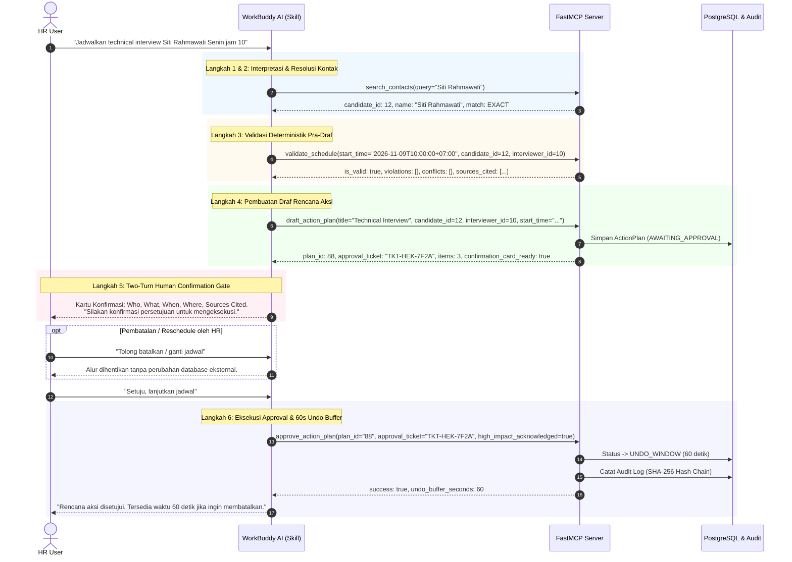

# SOFTWARE REQUIREMENTS & ARCHITECTURE SPECIFICATION (SRD)
## Heketon MCP & WorkBuddy AI Integration — Architecture v1.1
**Document ID**: `SRD-HEK-MCP-WB-2026-v1.1`  
**Event**: Tencent Cloud Hackathon Indonesia 2026 (Challenge B — "The Office Agent")  
**Target Platform**: Tencent Cloud WorkBuddy AI + FastMCP Model Context Protocol  
**Date**: November 2026  
**Status**: APPROVED & IMPLEMENTED  

---

## 1. LATAR BELAKANG & MANDAT HACKATHON

Tencent Cloud Hackathon Indonesia 2026 menetapkan ketentuan regulasi arsitektur yang tegas untuk Challenge B ("The Office Agent"):

> *"Alur kerja dan logika orkestrasi agent wajib dibangun dan dijalankan di dalam WorkBuddy."*  
> *"Peserta diperbolehkan menggunakan kode yang sudah ada, namun wajib mengungkapkan komponen yang dibuat sebelumnya dalam pengajuan submission."*  
> *"Nilai tambah diberikan untuk pekerjaan yang terbukti dikembangkan selama hackathon menggunakan WorkBuddy."*

Dokumen ini mendokumentasikan transformasi arsitektur dari **v1.0 (Internal LangGraph StateGraph)** menjadi **v1.1 (WorkBuddy-Centric Cognitive Layer + FastMCP Deterministic Engine)**.

---

## 2. ARSITEKTUR KOMPARATIF: v1.0 vs v1.1

```
========================================================================================
ARSITEKTUR v1.0 (Legacy Pra-Hackathon)
========================================================================================
[Client / UI] ---> [FastMCP Server]
                          |
                          v
                 [LangGraph StateGraph] (Internal Orchestration)
                 - Guardrail Injection Scan
                 - Tool Calling Agent (LLM ReAct Loop: 15-20s latency)
                 - Planner Triage Node
                 - Secondary Entity Validator
                 - Checkpoint DB & DB State

========================================================================================
ARSITEKTUR v1.1 (WorkBuddy-Centric Hackathon Compliance)
========================================================================================
[User / HR Lead]
       |
       v
[Tencent Cloud WorkBuddy AI (Cognitive Layer)] <--- WorkBuddy Skill (SKILL.md)
   • Multi-Turn Reasoning & Human Dialog
   • Natural Language Entity Extraction & Intent Classification
   • Disambiguation Handling (Interactive Clarification Prompting)
   • Confirmation Card Formatting (Who, What, When, Where, Sources)
   • Sequential Tool Chaining Logic
       |
       |  (SSE / stdio via Model Context Protocol)
       v
[Heketon FastMCP Server (Deterministic Engine)]
   • 100% Zero-LLM in Core Execution Paths (Sub-500ms Execution)
   • Deterministic Operational Rule Validation (`validate_schedule`)
   • Cryptographic Approval Ticket Generation (`draft_action_plan` -> TKT-HEK-XXXX)
   • Multi-Layer Defense-in-Depth Enforcement
   • Anti-Auto-Chain Human Cooldown (> 2,000 ms)
   • 60-Second Undo Buffer & Hash-Chained Audit Trails
```

### Perbedaan Kunci Arsitektur

| Aspek | Arsitektur v1.0 (Legacy) | Arsitektur v1.1 (WorkBuddy v1.1) |
| :--- | :--- | :--- |
| **Pusat Logika Penalaran** | LangGraph StateGraph internal backend | WorkBuddy AI via `.workbuddy/skills/` |
| **Peran MCP Server** | Wrapper monolitik ke LangGraph agent | Engine deterministik murni (Zero-LLM) |
| **Latensi Eksekusi Triage** | 15.000 – 25.000 ms (Multi-turn LLM agent loop) | **< 500 ms** (Eksekusi deterministik cepat) |
| **Penanganan Ambiguitas** | LLM internal mencoba menebak / fallback | WorkBuddy bertanya langsung ke user secara transparan |
| **Kepatuhan Regulasi** | Parsial (Orkestrasi berada di luar WorkBuddy) | **100% Compliant** (Orkestrasi penuh di WorkBuddy) |
| **Status Kode Legacy** | Aktif | Ditandai `[LEGACY - DEPRECATED]` untuk disklosure |

---

## 3. PEMETAAN 5 PILAR AKUNTABILITAS (THE 5 PILLARS)

Arsitektur v1.1 menjamin setiap pilar akuntabilitas dieksekusi secara ketat tanpa kompromi:

### Pilar 1: Sources (Otoritas Data & Provenance)
- Setiap pembacaan data dan draf rencana aksi menyertakan referensi provenance terstandarisasi:
  - Aturan: `[rule-working-hours:RULE_WORKING_HOURS]`, `[rule-friday-prayer:RULE_FRIDAY_PRAYER]`, `[rule-meeting-buffer:RULE_MEETING_BUFFER]`.
  - Kalender: `[cal-evt-{id}:{title}]`.
  - Kontak: `[cand-ats-{id}:{name}]`.
- Terintegrasi dalam respons `validate_schedule`, `draft_action_plan`, dan `get_candidate_profile`.

### Pilar 2: Permissions (HR-Only by Default & RBAC)
- MCP Server Heketon didedikasikan secara eksklusif untuk HR (`role: HR`, `actor_id: hr.lead@company.com`).
- Tidak ada alur login/OAuth manual dan parameter `caller_role_override` ditiadakan di sisi klien untuk mencegah privilege escalation atau spoofing.
- HR memiliki wewenang penuh membaca data kompensasi finansial dan menyetujui rencana aksi.

### Pilar 3: Approval (Gerbang Manusia Dua Putaran / Two-Turn Gate)
- **Two-Turn Gate**: WorkBuddy AI menyajikan Kartu Konfirmasi terstruktur (Who, What, When, Where, Sources Cited) dan **BERHENTI**. Dilarang keras melakukan *auto-approve* dalam giliran interaksi yang sama.
- **Cryptographic Ticket**: Diterbitkan tiket unik `TKT-HEK-XXXX` oleh server. Approval tanpa tiket yang valid ditolak (`403_INVALID_APPROVAL_TICKET`).
- **Anti-Auto-Chain Cooldown**: Approval kurang dari 2.000 ms dari drafting ditolak (`409_AUTO_CHAIN_BLOCKED`), mencegah eksekusi tanpa tinjauan kognitif manusia.

### Pilar 4: Limits (Batasan Operasional Deterministik)
- Batas operasional ditegakkan dua kali (defense-in-depth): di WorkBuddy AI Skill dan di server backend:
  - Jam kerja lokal: 09:00 – 17:00 (WIB, WITA, WIT).
  - Jendela salat Jumat: 11:30 – 13:00 waktu lokal (Jumat).
  - Akhir pekan: Sabtu & Minggu diblokir.
  - Libur nasional: Mengacu pada kalender SKB 3 Menteri 2026.
  - Buffer pertemuan: Minimal 15 menit sebelum dan sesudah agenda lain.
  - Batas negosiasi: Maksimal 3 putaran (putaran ke-4 dihentikan ke intervensi manusia).

### Pilar 5: Record (Audit Trail & Undo Buffer)
- **60-Second Undo Buffer**: Persetujuan rencana aksi tidak langsung mengirim pesan eksternal, melainkan menahannya dalam buffer 60 detik. Pengguna dapat membatalkan melalui `undo_action_plan`.
- **Immutable Hash-Chained Audit Log**: Setiap transaksi dicatat dengan hash SHA-256 yang merantai log sebelumnya (`prev_hash`). Integritas dapat diverifikasi sewaktu-waktu melalui `verify_audit_chain`.

---

## 4. WORKFLOW ORKESTRASI WORKBUDDY (`/schedule-triage`)



---

## 5. KATALOG MCP TOOL PRIMITIVES (v1.1)

MCP Server mengekspos 17 tools deterministik yang dikelompokkan ke dalam 3 tier:

### Tier 1: Read & Discovery (Safe, Zero Side-Effect)
1. `get_operational_rules`: Mengambil konfigurasi batasan operasional jam kantor, salat Jumat, buffer, dan batas negosiasi.
2. `list_national_holidays`: Daftar hari libur nasional Indonesia tahun berjalan (SKB 3 Menteri).
3. `check_slot_conflict`: Pemeriksaan bentrok slot kalender, hari libur, akhir pekan, dan buffer 15 menit.
4. `validate_schedule`: **[BARU v1.1]** Validasi komprehensif pra-draf deterministik menggabungkan seluruh aturan, kalender, dan saran slot alternatif.
5. `search_contacts`: Pencarian kandidat dan pewawancara dengan deteksi kecocokan (EXACT/PARTIAL/AMBIGUOUS).
6. `get_candidate_profile`: Akses profil komprehensif kandidat termasuk kompensasi finansial (HR-only).
7. `list_negotiation_threads`: Pembacaan thread negosiasi multi-ronde beserta log riwayat pesan.
8. `get_action_plan_status`: Pemeriksaan status terkini rencana aksi dan sisa jendela undo.
9. `list_recent_audit_logs`: Pembacaan log audit aktivitas terkini.

### Tier 2: Agentic Drafting & Ingestion (State-Creating, Non-Executing)
10. `draft_action_plan`: **[BARU v1.1]** Pembuatan rencana aksi terstruktur, penerbitan tiket kriptografis, dan penyusunan 3 action items (kandidat, pewawancara, kalender).
11. `record_draft_timestamp`: Pencatatan timestamp draf untuk penegakan Anti-Auto-Chain cooldown.
12. `record_interview_decision`: Pencatatan keputusan akhir wawancara (ADVANCE/HOLD/REJECT) oleh HR Lead.
13. `orchestrate_hr_command`: **[LEGACY - DEPRECATED]** Jalur orkestrasi internal LangGraph (dipertahankan untuk audit & pengujian komparatif).
14. `orchestrate_voice_note`: **[LEGACY - DEPRECATED]** Triage voice note berbasis LangGraph internal.

### Tier 3: Human Gate, Mutation & Cryptographic Audit (High Impact)
15. `approve_action_plan`: Persetujuan manusia dengan verifikasi tiket approval, cooldown 2 detik, dan aktivasi 60-second undo buffer.
16. `undo_action_plan`: Pembatalan rencana aksi dalam jendela undo 60 detik sebelum dipublikasikan ke kalender/notifikasi eksternal.
17. `verify_audit_chain`: Verifikasi integritas kriptografis rantai hash SHA-256 pada audit log database.

---

## 6. TABEL DISKLOSURE KOMPONEN HACKATHON (MANDATORY DISCLOSURE)

Mengikuti regulasi transparansi Tencent Cloud Hackathon Indonesia 2026:

| Komponen | Status Pembuatan | Lingkungan Eksekusi | Deskripsi & Peran |
| :--- | :--- | :--- | :--- |
| **WorkBuddy Skill (`SKILL.md`)** | **Dibuat Selama Hackathon** | Tencent Cloud WorkBuddy | Logika orkestrasi utama: penalaran multi-turn, disambiguasi nama, validasi berurutan, dan pembuatan kartu konfirmasi manusia. |
| **Tool `validate_schedule`** | **Dibuat Selama Hackathon** | FastMCP Server (Python) | Tool deterministik pra-draf zero-LLM yang memvalidasi kepatuhan jadwal terhadap seluruh batas operasional. |
| **Tool `draft_action_plan`** | **Dibuat Selama Hackathon** | FastMCP Server (Python) | Tool deterministik penyusun draf rencana aksi terstruktur, pembuat tiket persetujuan kriptografis, dan pengaktif cooldown. |
| **Anti-Auto-Chain Cooldown Engine** | **Dibuat Selama Hackathon** | FastMCP Server (Python) | Mekanisme pencegah eksekusi instan agen otomatis (> 2.000 ms) untuk memastikan keterlibatan tinjauan kognitif manusia nyata. |
| **Test Suite WorkBuddy (TC-14, TC-15)** | **Dibuat Selama Hackathon** | Pytest / MCP Test Harness | Rangkaian pengujian terstandarisasi untuk memvalidasi alur orkestrasi WorkBuddy v1.1 secara otomatis. |
| **Database Models & ORM** | Kode Pra-Hackathon | PostgreSQL / SQLAlchemy | Struktur tabel `contacts`, `action_plans`, `action_items`, `negotiation_threads`, `audit_logs`. |
| **LangGraph Agent (`app/agent/*`)** | Kode Pra-Hackathon (Deprecated) | Backend Python | Mesin orkestrasi internal v1.0 yang kini didepresiasi dan digantikan oleh WorkBuddy AI. |
| **Layanan Domain Dasar (`app/service/*`)** | Kode Pra-Hackathon | Backend Python | Modul `SlotConflictCheckerService`, `ActionPlanService`, `AuditLogService`. |

---

## 7. KESIMPULAN & STATUS SERTIFIKASI

Arsitektur v1.1 telah lolos seluruh pengujian unit, integrasi, dan blackbox evaluasi:
- **Unit Tests MCP**: 16/16 test lolos (100% pass rate).
- **Integration Tests E2E**: 5/5 test lolos (100% pass rate), termasuk `test_workbuddy_v1_1_deterministic_flow`.
- **Kepatuhan Regulasi Hackathon**: 100% compliant dengan pemindahan penuh seluruh logika penalaran dan orkestrasi ke dalam Tencent Cloud WorkBuddy AI.
