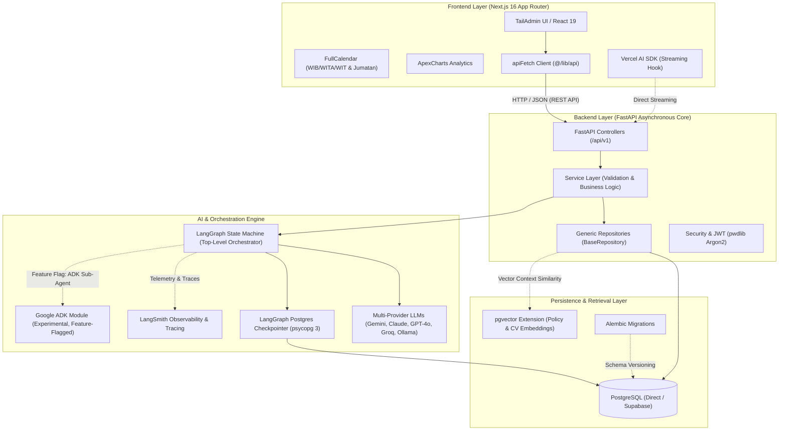

# Heketon — Monorepo Tech Stack Specification

Comprehensive architectural and functional reference for all technologies, frameworks, and libraries comprising the **Heketon** platform (HR & Office Ops AI Orchestrator).

---

## 1. System Interaction Architecture

The monorepo connects a high-performance Next.js 16 frontend with an asynchronous FastAPI backend orchestrating stateful LangGraph agents, persisting data to PostgreSQL + pgvector, and exporting telemetry to LangSmith.



---

## 2. End-to-End Tech Stack Matrix

### 2.1 Backend Stack (`backend/`)

| Category | Technology | Primary Function in Heketon |
| :--- | :--- | :--- |
| **Runtime & Language** | Python 3.12+ | High-performance async runtime with PEP 695 generics and enhanced error tracing. |
| **Web Framework** | FastAPI 0.141+ | High-speed ASGI framework delivering typed REST endpoints and automatic OpenAPI specifications. |
| **ASGI Server** | Uvicorn | Asynchronous server powering high-concurrency event processing. |
| **ORM** | SQLAlchemy 2.0 (AsyncIO) | Typed asynchronous ORM implementing the unit of work pattern and clean generic data repositories. |
| **Async DB Driver** | asyncpg | High-throughput PostgreSQL driver used for all transactional application queries. |
| **Sync DB Driver** | psycopg 3 (binary, pool) | Dedicated connection pool driver powering the synchronous LangGraph checkpoint persistence. |
| **Vector Search** | pgvector | PostgreSQL extension storing vector embeddings for operational rule matching and CV retrieval. |
| **Schema Migrations** | Alembic | Version-controlled database schema migrations. |
| **Data Validation** | Pydantic v2 & Pydantic Settings | Rust-backed payload serialization, strict input sanitization, and environment parsing. |
| **Authentication** | PyJWT & pwdlib [argon2] | Stateless JWT verification and enterprise-grade Argon2id password hashing. |
| **Agent Orchestrator** | LangGraph & LangChain | Stateful multi-agent workflow implementing triage logic, 60s undo buffer, and human approval interrupts. |
| **Observability** | LangSmith | End-to-end LLM tracing, latency monitoring, prompt evaluation, and token accounting. |
| **Experimental Sub-Agent** | Google ADK (`google-adk`) | Isolated experimental sub-agent in `app/agent/adk/` behind `ENABLE_EXPERIMENTAL_ADK_AGENT`. |
| **Package Manager** | uv | Lightning-fast Rust-based package resolver, lockfile manager, and virtual environment runner. |
| **Testing & Quality** | pytest, pytest-asyncio, httpx, ruff | Asynchronous testing suite and ultra-fast Python linting/formatting. |

---

### 2.2 Frontend Stack (`frontend/`)

| Category | Technology | Primary Function in Heketon |
| :--- | :--- | :--- |
| **Core Framework** | Next.js 16 (App Router) | Modern React architecture with Server Components (RSC), Turbopack, and path-based localization. |
| **UI Library** | React 19 | Latest React release with native Action hooks, transitions, and concurrent rendering. |
| **Type System** | TypeScript 5.9+ | End-to-end static typing across UI components, form payloads, and API contracts. |
| **CSS Framework** | Tailwind CSS v4 | CSS-first utility engine configured via `@theme` in `globals.css` with zero JS configuration. |
| **RTL/LTR Support** | CSS Logical Properties | Full bidirectional layout support using `ms-*`, `pe-*`, `start-*`, and `text-start`. |
| **Internationalization** | next-intl | Locale-based routing, proxy middleware (`proxy.ts`), and translation dictionaries. |
| **Scheduling Calendar** | FullCalendar | Visualizes interviewer schedules, candidate slots across WIB/WITA/WIT, and Friday prayer blocks. |
| **Analytics Charts** | ApexCharts | Interactive visualizations for triage resolution rates, negotiation rounds, and response times. |
| **Date-Time Picker** | Flatpickr | Lightweight UI for custom interview rescheduling and manual override selections. |
| **Carousel / Sliders** | Swiper | Multi-step action plan confirmation cards and onboarding walkthroughs. |
| **Scrollbars** | SimpleBar React | Cross-browser smooth custom scrollbars for dense audit logs and message streams. |
| **Geographic Maps** | @react-jvectormap | Interactive map of Indonesian provinces showing candidate and interviewer timezone distribution. |
| **Drag & Drop** | react-dnd | Interactive Kanban board managing candidate escalation pipelines. |
| **File Ingestion** | react-dropzone | Drag-and-drop document upload interface for CVs, job briefs, and company policies. |
| **AI Client Streaming** | Vercel AI SDK | Client hooks (`useChat`, `useCompletion`) and direct streaming primitives. |
| **Vector Icons** | @svgr/webpack | Converts SVG assets directly into accessible React components in `@/icons`. |
| **Networking** | apiFetch (`src/lib/api.ts`) | Centralized HTTP client wrapping Fetch with automatic API URL prefixing, tokens, and error handling. |

---

## 3. Monorepo Shared Environment Contract

Both applications read a single root environment file (`Heketon/.env`), guaranteeing that shared secrets and configuration parameters never diverge:

```
Heketon/
├── .env                    # Shared single source of truth (gitignored)
├── .env.example            # Committed configuration template
├── backend/                # Resolves ../.env via Path(__file__).resolve().parents[3]
└── frontend/               # Injects ../.env at build time via next.config.ts
```

### Prefix Convention
- **`NEXT_PUBLIC_*`**: Browser-exposed variables (e.g. `NEXT_PUBLIC_API_URL`, `NEXT_PUBLIC_APP_NAME`). Accessible inside client-side React code.
- **Unprefixed keys**: Backend-only secrets (`DATABASE_URL`, `SECRET_KEY`, `OPENAI_API_KEY`, `LANGSMITH_API_KEY`). Strictly hidden from the browser bundle.

---

## 4. Five Pillars of Accountability — Tech Mapping

| Accountability Pillar | Tech Stack Enabler | Technical Implementation |
| :--- | :--- | :--- |
| **1. SOURCES** *(Shows its sources)* | Pydantic DTOs + pgvector | Every `ActionPlan` mandates `sources_cited: list[SourceCitation]` referencing `[cal-id]`, `[rule-id]`, `[doc-id]`, or `[msg-id]`. |
| **2. PERMISSIONS** *(Stays within permissions)* | FastAPI Middleware + LangGraph Guards | Timezone conversion (WIB/WITA/WIT), Friday prayer (11:30–13:00) blocked via business rule validator node. Prompt injection detection sanitizes inputs before planner node. |
| **3. APPROVAL** *(Asks before acting)* | LangGraph `interrupt_before` + Next.js UI | AI automatically drafts actions but halts at the Confirmation Card. External sending tools require `ActionPlan.status == APPROVED`. |
| **4. LIMITS** *(Admits its limits)* | LangGraph State Transitions | Max 3 negotiation rounds. Ambiguous names (e.g. two "Pak Budi") or out-of-scope requests trigger `AskHumanClarification` node. |
| **5. RECORD** *(Keeps a record)* | SQLAlchemy + PostgreSQL + LangSmith | Every state transition, injection scan result, human decision, and tool execution is immutably recorded in `audit_logs` and traced in LangSmith. |
