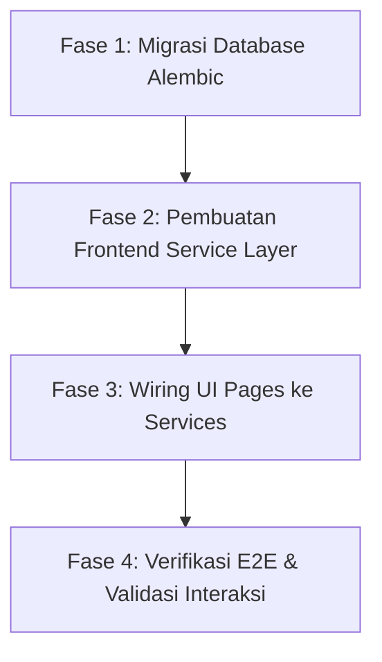

# Laporan Terpadu: Audit Integrasi End-to-End (E2E), Status Koneksi Frontend-Backend & Diagnostik Sistem

**Proyek**: Heketon — HR & Office Ops AI Orchestrator  
**Tanggal Audit**: 24 Oktober 2026  
**Auditor**: Antigravity Pair Programming Agent  
**Lingkungan**: Local Dev Environment (Windows x64, Node v20.x, Python 3.12, PostgreSQL 17)  
**Status Hubungan Frontend-Backend**: **BELUM TERKONEKSI (DISCONNECTED)**

---

## 1. Ringkasan Eksekutif (Executive Summary)

Pengujian *End-to-End* (E2E) dan audit konektivitas telah dilakukan dengan menjalankan backend (FastAPI, port `:8000`), frontend (Next.js 16 dengan Turbopack, port `:3000`), dan PostgreSQL secara simultan.

Hasil audit mengonfirmasi bahwa **saat ini frontend dan backend belum terhubung satu sama lain**. Frontend berjalan secara mandiri (*standalone*) menggunakan data tiruan lokal (*mock data*), sementara backend telah siap dengan arsitektur 5-layer dan amplop respon seragam, tetapi mengalami *schema mismatch* pada tabel database PostgreSQL akibat belum dilakukannya migrasi Alembic pasca-penambahan atribut model Layer 1.

| Komponen | Status Runtime | Status Integrasi | Keterangan |
| :--- | :---: | :---: | :--- |
| **Frontend (Next.js)** | Aktif (`:3000`) | Mocked | Menggunakan `src/data/mock*.ts`; belum memanggil `apiFetch` |
| **Backend (FastAPI)** | Aktif (`:8000`) | Standalone | Server sehat; endpoint in-memory bekerja normal |
| **Database (PostgreSQL)** | Aktif (`:5432`) | Desinkronisasi | Kolom baru model Layer 1 belum ada di PostgreSQL |
| **Computer-Use CLI** | Terdeteksi | Terbatas (Win32) | Provider Windows belum mendukung desktop accessibility tree |

---

## 2. Temuan Audit di Sisi Frontend (`http://localhost:3000`)

### 2.1 Ketergantungan Penuh pada Static Mock Data
Pemeriksaan kode sumber pada seluruh halaman fitur di bawah `frontend/src/app/[locale]/(admin)` menunjukkan bahwa seluruh state UI diinisialisasi langsung dari data statis:
- **Modul Kandidat** (`src/app/[locale]/(admin)/master/candidates/page.tsx`):
  ```tsx
  import { initialCandidates } from "@/data/mockMasterData";
  // ...
  const [candidates, setCandidates] = useState<Candidate[]>(initialCandidates);
  ```
- **Modul Orchestration & Triage** (`src/app/[locale]/(admin)/orchestration/scheduling/page.tsx`):
  ```tsx
  import { initialCandidates } from "@/data/mockMasterData";
  import { generateSampleActionPlan, initialAuditLogs } from "@/data/mockOrchestrationData";
  ```
- **Modul Triage Threads** (`src/app/[locale]/(admin)/orchestration/threads/page.tsx`):
  ```tsx
  import { initialNegotiationThreads } from "@/data/mockThreadAndCalendarData";
  ```
- **Modul Interview Sessions** (`src/app/[locale]/(admin)/interviews/sessions/page.tsx`):
  ```tsx
  import { initialInterviewSessions } from "@/data/mockInterviewData";
  ```

### 2.2 Lapisan Layanan API Masih Kosong (*Empty Barrel*)
- File `frontend/src/services/index.ts` hanya berisi:
  ```ts
  /**
   * API service modules for communicating with the FastAPI backend.
   */
  export {};
  ```
  Belum terdapat modul service terdefinisi (seperti `candidateService.ts`, `orchestratorService.ts`, `interviewService.ts`).
- Modul klien `frontend/src/lib/api.ts` (`apiFetch`) telah selesai diperbarui untuk membaca amplop respon seragam `{ success, message, data }`, tetapi belum diimpor atau dipanggil oleh komponen mana pun di seluruh repositori frontend.

### 2.3 Konstanta Endpoint Belum Memetakan Domain
File `frontend/src/constants/index.ts` saat ini hanya mendefinisikan endpoint kesehatan:
```ts
export const API_ENDPOINTS = {
  HEALTH: "/health",
} as const;
```
Endpoint domain seperti `/master/*`, `/orchestrator/*`, `/interviews/*`, `/calendar/*`, dan `/audit/*` belum dipetakan.

### 2.4 Bukti Jaringan (Network Log Trace)
Saat halaman `http://localhost:3000/master/candidates` diakses melalui peramban:
- Next.js Turbopack melakukan kompilasi dan mengembalikan status **HTTP 200 OK**.
- **Hasil Pantauan Server Backend**: Log server Uvicorn pada port `:8000` mencatat **0 (nol) request masuk**. Tidak ada lalu lintas HTTP yang terjadi antara Next.js/browser ke FastAPI.

---

## 3. Temuan Audit di Sisi Backend & Database (`http://localhost:8000`)

### 3.1 Status Server & Response Envelope
- Server FastAPI berjalan normal dengan *auto-reloader* aktif.
- Endpoint non-database bekerja 100% dan mematuhi standarisasi respon seragam `ApiResponse[T]`:
  - `GET /health` $\rightarrow$ `{"status":"ok","service":"Heketon API"}`
  - `GET /api/v1/simulator/quick-presets` $\rightarrow$ `{"success":true,"message":"Berhasil mengambil daftar preset balasan cepat","data":[...]}`
  - `GET /api/v1/orchestrator/scenarios` $\rightarrow$ `{"success":true,"message":"Berhasil mengambil daftar preset skenario","data":[...]}`

### 3.2 Pending Migration di PostgreSQL (Schema Desynchronization)
Ketika endpoint yang mengakses database dipanggil secara langsung (misalnya `GET /api/v1/master/candidates`), backend mengembalikan respon HTTP 500 terenkapsulasi:
```json
{
  "success": false,
  "message": "Terjadi kesalahan internal pada server. Silakan hubungi admin.",
  "data": null
}
```

**Log Galat Server (Uvicorn / SQLAlchemy)**:
```text
sqlalchemy.exc.ProgrammingError: (sqlalchemy.dialects.postgresql.asyncpg.ProgrammingError) column tblm_candidate.vpreferred_channel does not exist
[SQL: SELECT tblm_candidate.vcandidate_code, tblm_candidate.vname, tblm_candidate.vemail, tblm_candidate.vphone_number, tblm_candidate.vpreferred_channel, tblm_candidate.vjob_position, tblm_candidate.vstatus, tblm_candidate.vtimezone, tblm_candidate.vresume_url, tblm_candidate.vnotes, tblm_candidate.ncurrent_salary, tblm_candidate.nexpected_salary, tblm_candidate.nid, tblm_candidate.vcrea, tblm_candidate.dcrea, tblm_candidate.vmodi, tblm_candidate.dmodi 
FROM tblm_candidate 
 LIMIT $1::INTEGER OFFSET $2::INTEGER]
```

**Analisis Penyebab**:
1. Pada perbaikan Layer 1 (Model ORM), dilakukan penambahan kolom dan model baru:
   - `Candidate` (`tblm_candidate`): `vpreferred_channel`, `vstatus`, `vtimezone`, `vresume_url`, `vnotes`.
   - `User` (`tblm_user`): `vphone_number`, `vworking_hours`.
   - `WorkCalendar` (`tblm_calendar`): `nmax_negotiation_rounds`, `nbuffer_minutes`, `binjection_guardrail_enabled`.
   - Tabel Baru: `CalendarEvent` (`tblt_calendar_event`), `NegotiationThread` (`tblt_negotiation_thread`), `ThreadMessage` (`tblt_thread_message`).
2. Perubahan di atas baru diterapkan pada berkas model Python SQLAlchemy, sedangkan skema database PostgreSQL masih berada pada migrasi lama (`20261023_0001_create_interview_copilot_schema_v2.py`).
3. Belum ada berkas migrasi baru yang di-*generate* (`alembic revision --autogenerate`) dan dieksekusi (`alembic upgrade head`).

---

## 4. Evaluasi Lingkungan Computer-Use (`orca computer`)

Pengecekan kesiapan *Computer-Use* otomatis dilakukan menggunakan CLI Orca:
1. `orca computer capabilities --json`:
   - Provider terdeteksi: `orca-computer-use-windows` v1.0.0.
   - PIDs didukung, namun `bundleIds` tidak didukung pada Windows.
2. `orca computer permissions --json`:
   - Kapabilitas `accessibility` berstatus `unsupported`.
   - Kapabilitas `screenshots` berstatus `unsupported`.
3. **Metodologi Pengujian Pengganti**:
   Karena runtime helper Windows tidak menyediakan akses accessibility tree untuk jendela browser, audit dilakukan secara komprehensif menggunakan kombinasi pengujian proses live, verifikasi port TCP, simulasi request HTTP, penelusuran log compiler Turbopack, dan analisis statis kode sumber.

---

## 5. Rencana Tindakan Perbaikan (Action Plan)

Untuk menghubungkan frontend dan backend secara utuh, disarankan langkah-langkah terstruktur berikut:



### Fase 1: Sinkronisasi Skema Database (Backend)
1. Buat migrasi baru Alembic untuk merefleksikan perubahan Layer 1:
   ```bash
   cd backend
   uv run alembic revision --autogenerate -m "add_orchestration_and_extended_model_fields"
   ```
2. Jalankan migrasi ke PostgreSQL:
   ```bash
   uv run alembic upgrade head
   ```
3. Verifikasi seed data dasar (interviewer, kebijakan kalender, profil kandidat).

### Fase 2: Implementasi Frontend Service Layer
1. Definisikan pemetaan endpoint lengkap di `frontend/src/constants/index.ts`:
   - `MASTER`: `/master/candidates`, `/master/contacts`, `/master/operational-rules`, dll.
   - `ORCHESTRATOR`: `/orchestrator/command`, `/orchestrator/plans/current`, `/orchestrator/threads`, dll.
   - `INTERVIEWS`: `/interviews/sessions`, `/interviews/sessions/:id/decision`, dll.
   - `AUDIT`: `/audit/logs`.
2. Buat modul typed service di `frontend/src/services/`:
   - `masterService.ts`
   - `orchestrationService.ts`
   - `interviewService.ts`
   - `calendarService.ts`
   - `simulatorService.ts`
   - `auditService.ts`
   Seluruh modul memanggil `apiFetch<T>` dan mengembalikan tipe DTO terikat kontrak API.

### Fase 3: Wiring Komponen UI
1. Ganti state awal berbasis mock (`useState(initialCandidates)`) dengan *data fetching* reaktif (`useEffect` atau custom hook `useQuery`/fetch handler).
2. Tampilkan indikator *loading skeleton* dan penanganan *error banner* saat panggilan API berlangsung.
3. Hubungkan form penambahan kandidat, perubahan status, dan pengiriman perintah natural language ke fungsi service masing-masing.

### Fase 4: Validasi & Pengujian E2E Akhir
1. Buka antarmuka web, lakukan penambahan data kandidat, dan pastikan data tersimpan di PostgreSQL.
2. Pantau log server backend untuk memverifikasi bahwa kode status respons adalah `200 OK` dengan envelope `ApiResponse`.

---

**Catatan Akhir**:  
Laporan ini telah disimpan di [`docs/audit/INTEGRATION_AUDIT_REPORT.md`](file:///D:/Project/Heketon/docs/audit/INTEGRATION_AUDIT_REPORT.md). Sesuai batasan instruksi, belum ada modifikasi kode pada frontend maupun backend yang diterapkan sampai instruksi lanjutan diberikan.
