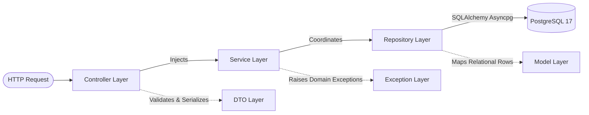

# Backend Architecture & File Structure Specification

Dokumen ini merupakan panduan arsitektur teknis dan struktur berkas untuk backend **Heketon** (HR & Office Ops AI Orchestrator). Backend dibangun menggunakan **FastAPI**, **SQLAlchemy 2.0 (AsyncIO)**, dan **Pydantic v2** dengan mengadopsi prinsip **Layered Architecture** dan **Single Responsibility Principle (SRP)**.

---

## 1. Prinsip Desain & Alur Dependensi

Arsitektur backend memisahkan tanggung jawab (Separation of Concerns) secara tegas ke dalam lapisan-lapisan independen. Aliran ketergantungan (dependencies) bersifat **unidireksional** dan dilarang melompati lapisan:

$$\text{Controller (HTTP Router)} \longrightarrow \text{Service (Business Logic)} \longrightarrow \text{Repository (Data Access)} \longrightarrow \text{Model (ORM Entity)}$$



### Tanggung Jawab Setiap Lapisan:
1. **Controller Layer (`app/controller/`)**:
   - Menangani siklus hidup HTTP request/response.
   - Melakukan validasi parameter query, path, dan request body melalui Pydantic DTO.
   - Menginjeksi database session (`Depends(get_db)`) dan pagination helper (`Depends()`).
   - Membungkus output ke dalam standar envelope `ApiResponse[T]`.
   - **Dilarang keras**: Menaruh business logic kompleks atau query SQL langsung di dalam controller.
2. **Service Layer (`app/service/`)**:
   - Berisi business logic, orkestrasi skenario, validasi aturan domain, dan perhitungan kuota/waktu.
   - Mengatur transaction boundary (`commit`, `flush`, `rollback`).
   - Melempar custom exception (`NotFoundException`, `ConflictException`, dll.) jika terjadi anomali bisnis.
3. **Repository Layer (`app/repository/`)**:
   - Abstraksi murni akses data ke PostgreSQL melalui SQLAlchemy 2.0.
   - Mewarisi `BaseRepository[ModelType]` untuk operasi CRUD generic.
   - Mengoptimalkan pembacaan relasi dengan `selectinload` untuk mencegah N+1 query issue.
   - **Dilarang keras**: Menaruh logika validasi bisnis di repository.
4. **DTO Layer (`app/dto/`)**:
   - Mendefinisikan schema kontrak data transfer objek request & response menggunakan Pydantic v2.
   - Mendukung automatic typing, validasi format, dan serialization helper.
5. **Model Layer (`app/model/`)**:
   - Definisi entitas tabel ORM SQLAlchemy 2.0 menggunakan `Mapped` dan `mapped_column`.
   - Menyediakan metadata naming convention, timestamp tracking (`created_at`/`updated_at` atau `dcrea`/`dmod`), dan database check constraints.
6. **Exception & Cross-Cutting Layer (`app/exception/`, `app/core/`, `app/db/`)**:
   - Exception handling terpusat yang menghasilkan format response error seragam.
   - Konfigurasi berbasis environment (`pydantic-settings`), utilitas kriptografi (Argon2, JWT), dan manajemen koneksi database async.

---

## 2. Aturan Penamaan Berkas (Strict CamelCase / PascalCase)

Seluruh berkas fungsional pada backend diwajibkan menggunakan penamaan **CamelCase (PascalCase)** untuk menjaga maintainability, keterbacaan, dan modularitas SRP:

| Lapisan / Modul | Pola Penamaan Berkas | Contoh Berkas |
| :--- | :--- | :--- |
| **Controller** | `<Domain>Controller.py` | `CandidateController.py`, `ActionPlanController.py` |
| **Service** | `<Domain>Service.py` | `CandidateService.py`, `ActionPlanService.py` |
| **Repository** | `<Domain>Repository.py` | `CandidateRepository.py`, `ActionPlanRepository.py` |
| **Data Transfer Object** | `<Domain>DTO.py` | `CandidateDTO.py`, `ActionPlanDTO.py` |
| **Domain Model** | `<Domain>Model.py` | `CandidateModel.py`, `CalendarModel.py` |
| **Exception** | `<Domain>Exception.py` | `CustomException.py`, `ExceptionHandler.py` |
| **Core Utilities** | `App<Functionality>.py` | `AppConfig.py`, `AppSecurity.py` |
| **Database Session** | `Database<Functionality>.py` | `DatabaseSession.py` |

> [!NOTE]
> File barrel `__init__.py` di setiap sub-direktori mengekspor seluruh komponen utama sehingga import dapat dilakukan langsung dari namespace folder, contoh: `from app.model import Candidate, User` atau `from app.dto import CandidateDTO`.

### Aturan Penamaan URL Endpoint (camelCase):
Semua rute REST API di bawah prefix `/api/v1` menggunakan konvensi **camelCase**:
- `/api/v1/candidates`
- `/api/v1/operationalRules`
- `/api/v1/actionPlans`
- `/api/v1/negotiationThreads`
- `/api/v1/calendarMatrix/events`
- `/api/v1/slotConflictChecker/check`

---

## 3. Peta Struktur Direktori Backend

```
backend/
├── alembic/                          # Konfigurasi & versi migrasi skema PostgreSQL
│   ├── versions/
│   │   └── 06784f3e4d33_add_orchestration_and_extended_model_.py
│   └── env.py                        # Runner migrasi async SQLAlchemy
├── app/
│   ├── controller/                   # 16 Standalone CamelCase HTTP Routers
│   │   ├── __init__.py
│   │   ├── ActionPlanController.py
│   │   ├── AuditLogController.py
│   │   ├── CalendarMatrixController.py
│   │   ├── CandidateController.py
│   │   ├── ContactController.py
│   │   ├── HolidayController.py
│   │   ├── InterviewDecisionController.py
│   │   ├── InterviewSessionController.py
│   │   ├── InterviewTranscriptController.py
│   │   ├── NegotiationThreadController.py
│   │   ├── OperationalPolicyController.py
│   │   ├── OrchestratorCommandController.py
│   │   ├── RubricController.py
│   │   ├── SimulatorEmailController.py
│   │   ├── SimulatorWhatsAppController.py
│   │   └── SlotConflictCheckerController.py
│   ├── service/                      # 16 Standalone CamelCase Business Services
│   │   ├── __init__.py
│   │   ├── ActionPlanService.py
│   │   ├── AuditLogService.py
│   │   ├── CalendarMatrixService.py
│   │   ├── CandidateService.py
│   │   ├── ContactService.py
│   │   ├── HolidayService.py
│   │   ├── InterviewDecisionService.py
│   │   ├── InterviewSessionService.py
│   │   ├── InterviewTranscriptService.py
│   │   ├── NegotiationThreadService.py
│   │   ├── OperationalPolicyService.py
│   │   ├── OrchestratorCommandService.py
│   │   ├── RubricService.py
│   │   ├── SimulatorEmailService.py
│   │   ├── SimulatorWhatsAppService.py
│   │   └── SlotConflictCheckerService.py
│   ├── repository/                   # 12 Standalone CamelCase Async Repositories
│   │   ├── __init__.py
│   │   ├── BaseRepository.py         # Generic async CRUD (PEP 695 type parameters)
│   │   ├── ActionPlanRepository.py
│   │   ├── AuditLogRepository.py
│   │   ├── CalendarMatrixRepository.py
│   │   ├── CandidateRepository.py
│   │   ├── ContactRepository.py
│   │   ├── HolidayRepository.py
│   │   ├── InterviewDecisionRepository.py
│   │   ├── InterviewSessionRepository.py
│   │   ├── InterviewTranscriptRepository.py
│   │   ├── NegotiationThreadRepository.py
│   │   ├── OperationalPolicyRepository.py
│   │   └── RubricRepository.py
│   ├── dto/                          # 16 Standalone CamelCase Pydantic DTOs
│   │   ├── __init__.py
│   │   ├── BaseDTO.py                # ApiResponse, PaginatedResponse, PaginationParams
│   │   ├── ActionPlanDTO.py
│   │   ├── AuditLogDTO.py
│   │   ├── CalendarMatrixDTO.py
│   │   ├── CandidateDTO.py
│   │   ├── ContactDTO.py
│   │   ├── HolidayDTO.py
│   │   ├── InterviewDecisionDTO.py
│   │   ├── InterviewSessionDTO.py
│   │   ├── InterviewTranscriptDTO.py
│   │   ├── NegotiationThreadDTO.py
│   │   ├── OperationalPolicyDTO.py
│   │   ├── OrchestratorCommandDTO.py
│   │   ├── RubricDTO.py
│   │   ├── SimulatorEmailDTO.py
│   │   ├── SimulatorWhatsAppDTO.py
│   │   └── SlotConflictCheckerDTO.py
│   ├── model/                        # 11 CamelCase SQLAlchemy 2.0 Domain Entities
│   │   ├── __init__.py
│   │   ├── BaseModel.py              # Base declarative & TableBaseModel mixins
│   │   ├── AuditModel.py             # SystemLog & AuditLog
│   │   ├── CalendarModel.py          # WorkCalendar & Holiday
│   │   ├── CandidateModel.py         # Candidate & ATS profile
│   │   ├── FollowupModel.py          # FollowupPlan & ActionRecipient
│   │   ├── InterviewModel.py         # Interview & SourceFile
│   │   ├── JobModel.py               # Job & TranscriptSegment
│   │   ├── OrchestrationModel.py     # CalendarEvent, NegotiationThread, ThreadMessage
│   │   ├── RubricModel.py            # Profile & Competency rubrics
│   │   ├── SummaryModel.py           # Flag, SummaryPoint, SummaryEvidence, HrDecision
│   │   └── UserModel.py              # User & Permission
│   ├── exception/                    # Global Exception Architecture
│   │   ├── __init__.py
│   │   ├── CustomException.py        # AppException, NotFoundException, ConflictException, dll.
│   │   └── ExceptionHandler.py       # Global FastAPI exception handler registers
│   ├── core/                         # Core Utilities & Configurations
│   │   ├── __init__.py
│   │   ├── AppConfig.py              # Pydantic Settings (loads shared root .env)
│   │   └── AppSecurity.py            # Argon2 password hashing & JWT utilities
│   ├── db/                           # Async Database Engine & Session Provider
│   │   ├── __init__.py
│   │   └── DatabaseSession.py        # engine, AsyncSessionLocal, get_db dependency
│   ├── constant/                     # Application enums & static lookup constants
│   ├── middleware/                   # ASGI middleware (CORS, timing, audit headers)
│   ├── util/                         # Date/time & timezone utilities
│   └── main.py                       # Application entry point & router mounting
├── scripts/                          # Utility & automation scripts
│   ├── check_db.py                   # Health check DB & pgvector extension
│   └── seed.py                       # Dev database seeder
├── tests/                            # Pytest Test Suite (36 suites passing)
│   ├── conftest.py                   # Async HTTP client & engine disposal fixtures
│   ├── test_health.py                # Health endpoint test
│   ├── unit/                         # Unit tests (DTOs, Rules, Pagination, Handlers)
│   └── integration/                  # Comprehensive endpoint integration tests
└── pyproject.toml                    # uv dependency manifest & Ruff lint configuration
```

---

## 4. Penjelasan Rinci Pola & Implementasi

### 4.1. Base Repository Pattern
[`BaseRepository[ModelType: Base]`](file:///D:/Project/Heketon/backend/app/repository/BaseRepository.py) memanfaatkan generic Python 3.12 (PEP 695) untuk menyediakan fungsi CRUD dasar secara otomatis:
- `get_by_id(id)`: Mampu menerima integer `nid` maupun string UUID secara cerdas.
- `create(attributes)`: Menambahkan objek baru dan mengeksekusi `session.commit()` dan `refresh()`.
- `update(entity, attributes)`: Memperbarui kolom entitas dan mengeksekusi `commit()`.
- `delete(entity)`: Menghapus entitas dari database.
- `paginate(offset, limit)`: Mengembalikan data beserta total baris.

### 4.2. Dependency Injection di Controller
Setiap controller menginjeksi database session dan parameter paginasi secara deklaratif:

```python
@router.get("", response_model=ApiResponse[PaginatedResponse[CandidateDTO]])
async def list_candidates(
    query: str | None = Query(None),
    params: PaginationParams = Depends(),
    db: AsyncSession = Depends(get_db),
) -> ApiResponse[PaginatedResponse[CandidateDTO]]:
    service = CandidateService(db)
    result = await service.list_candidates(query=query, params=params)
    return ApiResponse(data=result, message="Berhasil mengambil data kandidat")
```

### 4.3. Exception Handling Terpusat
Ketika terjadi kondisi anomali di Service Layer:
```python
if not candidate:
    raise NotFoundException(f"Kandidat dengan ID {cand_id} tidak ditemukan.")
```
[`ExceptionHandler.py`](file:///D:/Project/Heketon/backend/app/exception/ExceptionHandler.py) otomatis menangkap exception tersebut dan mengembalikan status code 404 dengan JSON terstandarisasi:
```json
{
  "success": false,
  "message": "Kandidat dengan ID 999 tidak ditemukan.",
  "data": null
}
```
